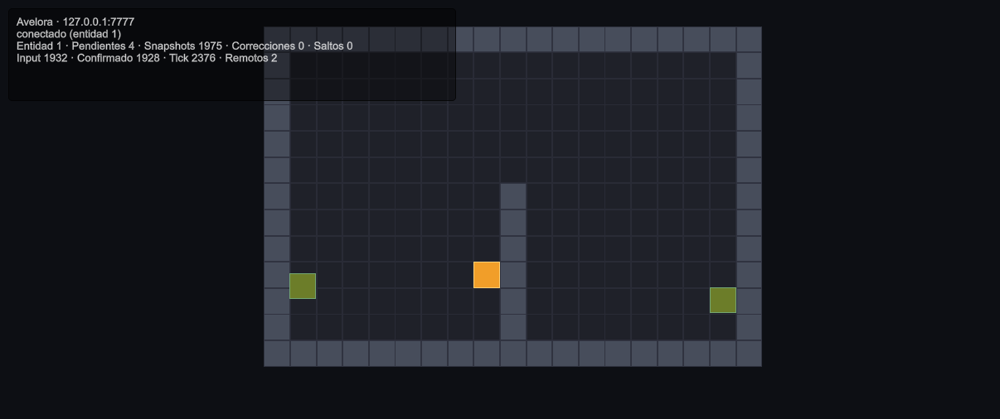

# Avelora — núcleo del servidor autoritativo (C#)

Implementación por etapas del *plan del servidor* de Avelora: un MMORPG 2D con **servidor
autoritativo en C# (.NET)** que comparte con el cliente de Unity el código que ambos deben
calcular igual (movimiento y colisión).

> **Estado: Etapas F, G e I-03c cerradas, Etapa H en curso; I-04 a I-09 de servidor implementadas (clientes I-04b/I-05b/I-06b/I-07b/I-09b pendientes).** El servidor guarda **cuentas y personajes en
> SQLite** detrás de `IPlayerRepository`, y el login ya es real: **PBKDF2-HMAC-SHA256 con 600 000
> iteraciones**, registro con **código de invitación** y límites de intentos por cuenta. Desde H-02
> (**protocolo v4**) la contraseña y la invitación viajan **cifradas con RSA** contra un reto de un
> solo uso; al entrar, el personaje aparece en la posición que tenía guardada si el mapa coincide.
> Desde I-01 el mundo tiene enemigos que el servidor mueve y todos ven; desde I-02 (**protocolo v5**)
> esos enemigos tienen vida, reciben los ataques de los jugadores, mueren y reaparecen. Desde I-03
> persiguen y golpean al jugador, y el jugador tiene vida, muerte y reaparición. Desde I-03c
> (**protocolo v6**) el snapshot lleva el tipo de cada PNJ (2001, 2002…) y el tope baja a 67 entidades.
> Desde I-04 (**protocolo v7**) hay botín en el suelo, recogida, inventarios persistentes y pociones;
> desde I-05 (**protocolo v8**) hay armas, equipo persistente y catálogo de objetos enviado al cliente.
> Desde I-06 (**protocolo v9**) las muertes de PNJ dan experiencia y suben niveles; I-08 añade clases,
> atributos, defensa y nivel máximo 25 con **esquema SQLite v4**, sin cambiar el protocolo. La vida y el
> daño dependen de la clase y de los puntos repartidos, no crecen automáticamente al subir nivel.
> Desde I-07 (**protocolo v10**) hay chat básico de zona con validación UTF-8 y límite de ritmo por jugador.
> Desde I-09 (**protocolo v11**) los jugadores reparten atributos y pueden reajustarlos con la piedra 3201.
> Ver [Etapa H](#qué-hace-la-etapa-h), [Etapa I](#qué-hace-la-etapa-i),
> [I-03c](#tipo-de-entidad-en-el-snapshot-i-03c-protocolo-v6), [I-04](#botín-e-inventario-i-04),
> [I-05](#armas-y-equipo-i-05-protocolo-v8), [I-06/I-08](#experiencia-niveles-y-clases-i-06-i-08),
> [I-07](#chat-i-07-protocolo-v10) e [I-09](#reparto-y-reajuste-de-atributos-i-09-protocolo-v11).
>
> Si la misma cuenta entra dos veces, la sesión anterior recibe `Reject(LoggedInElsewhere)` y se
> cierra con un **retardo** para que el mensaje llegue. El guardado corre en su propio hilo —al
> desconectar, cada minuto y al apagar—, así que el tick nunca espera a SQLite.

| Comprobación | Resultado |
| --- | --- |
| `dotnet build Avelora.slnx` | **0 errores, 0 advertencias** |
| `dotnet test Avelora.slnx` | **541/541 en verde** |
| Compilación en Unity 6 (cliente de F-02) | **0 errores, 0 avisos** |
| Escena `AveloraEtapaA` en Play con servidor | login con `dev`, posición guardada entre sesiones y expulsión `LoggedInElsewhere` |



> La captura es de la Etapa D. La Etapa E no cambia la vista por defecto (radio amplio); solo
> recorta los snapshots cuando el radio se reduce.

---

## Requisitos

- **.NET SDK 10** para `shared`, `server`, `tools` y las pruebas.
- **Unity 6** (`6000.6.5f1`) para el cliente. El proyecto de Unity activo es
  `E:\Unity\Nueva carpeta\My project (1)` (plantilla **2D / URP**, **Input System**, **Tilemap**).

No hace falta Unity para compilar lo compartido ni para ejecutar las pruebas.

---

## Estructura del repositorio

```
Avelora/
├─ shared/Avelora.Shared/           # Código compartido (netstandard2.1, C# 9, sin dependencias)
│   ├─ Avelora.Shared.asmdef        #   Ensamblado de Unity con «No Engine References»
│   ├─ SimulationConstants.cs       #   Tick rate y dt: el paso que comparten cliente y servidor
│   ├─ EntityKind.cs                #   Tipo de entidad (viaja en el snapshot)
│   ├─ Core/Vec2.cs                 #   Vector 2D (tipo de valor)
│   ├─ Core/MapCollisionGrid.cs     #   Matriz de colisión de tiles + AABB
│   ├─ Core/MovementSimulator.cs    #   Paso de movimiento (cliente y servidor)
│   ├─ Core/SequenceMath.cs         #   Comparación de secuencias con vuelta de uint
│   ├─ Maps/MapFile.cs              #   Formato binario .avmap y huella SHA-256
│   ├─ Prediction/                  #   Predicción y reconciliación del cliente
│   │   ├─ ClientPrediction.cs      #     Inputs pendientes, replay y corrección suave
│   │   └─ SnapshotTimeline.cs      #     Historial e interpolación de entidades remotas
│   └─ Protocol/                    #   Mensajes binarios: tipos, códec y cuantización
├─ shared/Avelora.Net/              # Transporte (netstandard2.1) sobre LiteNetLib 1.3.5
│   ├─ Avelora.Net.asmdef           #   Ensamblado de Unity (sin referencias a UnityEngine)
│   ├─ TransportContracts.cs        #   IServerTransport / IClientTransport (sin tipos de LiteNetLib)
│   ├─ LiteNetLibServerTransport.cs #   Servidor UDP
│   └─ LiteNetLibClientTransport.cs #   Cliente UDP (bots y cliente de Unity)
├─ server/Avelora.Server/           # Servidor headless (net10.0)
│   ├─ Program.cs                   #   Monta zona + red y arranca el bucle (Ctrl+C para parar)
│   ├─ server.json                  #   Configuración externa (tick, red, límites, rutas)
│   ├─ npcs.json                    #   Tipos (vida y reaparición) y puntos de aparición (I-01/I-02)
│   ├─ Simulation/                  #   Bucle, zona, movimiento, colas de entrada, área de interés
│   ├─ Net/                         #   Sesiones, handshake, entrada y snapshots filtrados
│   ├─ Entities/                    #   Entity, PlayerEntity, Id, almacén y grilla espacial
│   ├─ Metrics/                     #   Duración de tick: media, p99, sobrepasos
│   └─ Diagnostics/                 #   Informes por consola
├─ tools/Avelora.Bots/              # Clientes de consola por UDP (net10.0)
├─ maps/avelora-etapa-a.avmap       # Mapa exportado del Tilemap (contenido, se versiona)
├─ client/Assets/Avelora/           # Cliente Unity (fuente de verdad, se sincroniza)
│   ├─ Scenes/AveloraEtapaA.unity   #   Escena de prueba versionada (Player con NetworkClient)
│   ├─ Scripts/Game/                #   AveloraMap, LocalPlayerController, TilemapCollision,
│   │                               #   NetworkClient, RemotePlayerView, KeyboardDirection
│   ├─ Plugins/LiteNetLib.dll       #   Transporte UDP para Unity (netstandard2.1, 1.3.5)
│   ├─ Editor/                      #   Exportador del Tilemap a .avmap
│   └─ Art/, Tiles/                 #   Sprites y tiles de la escena (versionados)
├─ tests/Avelora.Tests/             # xUnit: geometría, mapa, servidor, protocolo, predicción y UDP
├─ tools/sync-shared-to-unity.ps1   # Copia shared + client al proyecto de Unity
└─ docs/capturas/                   # Capturas de la verificación (etapa-a.png, etapa-d.png)
```

`Avelora.Shared` es **netstandard2.1 y C# 9 a propósito**: Unity consume los mismos fuentes y el
servidor los referencia como ensamblado. **No tiene ninguna dependencia** (ni Unity ni NuGet), para
que copiarlo a Unity sea copiar archivos. Su `Avelora.Shared.asmdef` marca **«No Engine
References»**: si alguien escribe `using UnityEngine` ahí, Unity no compila. `Avelora.Net` sí
referencia LiteNetLib, pero la simulación no la conoce: solo ve las interfaces de transporte. La
lógica de predicción e interpolación también vive en `Avelora.Shared/Prediction` (sin Unity), para
poder probarla con xUnit; `NetworkClient` solo la conecta con el transporte y con el `Transform`.

---

## Puesta en marcha

### Backend y pruebas

```powershell
# Desde la raíz del repositorio
dotnet build Avelora.slnx -v q --nologo
dotnet test  Avelora.slnx
```

### Servidor

```powershell
# Arranca y se para con Ctrl+C. Escucha en UDP 7777.
dotnet run --project server/Avelora.Server

# Durante N segundos (útil para pruebas automáticas) u otra configuración
dotnet run --project server/Avelora.Server -- --seconds 15
dotnet run --project server/Avelora.Server -- mi-configuracion.json
```

La configuración (`server.json`) se copia junto al ejecutable; si no existe, el servidor escribe
una con los valores por defecto. La ruta del mapa (`maps/avelora-etapa-a.avmap`) se busca junto a
la configuración, en el directorio actual y junto al ejecutable.

### Bots (clientes por UDP)

Con el servidor en marcha, en otra consola:

```powershell
# Un bot durante 10 s
dotnet run --project tools/Avelora.Bots

# Tres bots, 15 s, contra otro puerto
dotnet run --project tools/Avelora.Bots -- --bots 3 --seconds 15
dotnet run --project tools/Avelora.Bots -- --host 127.0.0.1 --port 7777 --bots 10
```

Cada bot hace el handshake real, manda una intención cada 50 ms y lee snapshots. Al final imprime su
entidad, los snapshots recibidos y dónde acabó.

### Cliente Unity

1. Arranca el servidor (`dotnet run --project server/Avelora.Server`).
2. Abre el proyecto en Unity 6 y la escena **`Assets/Avelora/Scenes/AveloraEtapaA.unity`**.
3. Pulsa **Play**. El `NetworkClient` del `Player` hace el handshake contra
   **127.0.0.1:7777** (los mismos valores de `server.json`).
4. Muévete con **WASD** o las **flechas**. El overlay muestra estado, entidad, inputs pendientes,
   snapshots, correcciones y saltos; los demás jugadores aparecen como cuadrados con otro tinte.

**Controles:** movimiento en ocho direcciones. La diagonal está normalizada (no es más rápida).
Si el servidor no está levantado, el cliente muestra «sin respuesta»/«desconectado» y **R**
reintenta la conexión. Para jugar sin red (solo Etapa A), desactiva `connectOnStart` en el
inspector: el `LocalPlayerController` sigue funcionando como antes.

> ⚠️ **Editor sin foco:** Unity pausa el modo Play cuando el Editor pierde el foco si
> *Run In Background* está desactivado. Para pruebas automatizadas, actívalo
> (`Application.runInBackground = true` o *Edit → Project Settings → Player*). Si se pausa, el
> servidor puede cerrar la conexión por timeout; al volver, el cliente lo indica y **R** reconecta.

---

## Qué hace la Etapa A

### `Vec2`
Vector 2D `readonly struct`. No asigna en el heap (importante dentro del bucle de ticks), con
suma, resta, escala, longitud y `Normalized()`.

### `MapCollisionGrid`
Matriz de tiles con celdas libres/bloqueadas:

- **Fuera de la rejilla cuenta como bloqueado**, para que nadie salga del mapa por un borde.
- **`IsBoxWalkable`** comprueba **todos** los tiles que toca la caja del personaje, no solo su
  punto central (el error clásico que deja «colarse» por las esquinas).
- Las consultas usan **coordenadas de tile absolutas**: el origen de la rejilla se resta dentro,
  así un Tilemap con celdas negativas funciona sin que cliente ni servidor desplacen nada.
- `Overlaps` para contacto/alcance entre dos cajas (AABB).

### `MovementSimulator`
El paso de movimiento compartido:

- El **`dt` es constante** (1 / tick rate); el cliente nunca aporta tiempo.
- La **velocidad la impone el servidor**; el cliente nunca la envía.
- La **diagonal se normaliza aquí**, así que moverse en diagonal no es más rápido.
- Se mueve **cada eje por separado**: el personaje **se desliza** por las paredes en vez de
  quedarse pegado.
- `IsValidDirection` valida que la dirección sea −1, 0 o 1.

### Formato de mapa `.avmap`
El servidor nunca lee escenas de Unity: la colisión se **exporta desde el Tilemap** a este
archivo binario, y cliente y servidor cargan el mismo.

```
Offset  Tamaño  Campo
  0       4     Magic "AVMP"
  4       2     FormatVersion (ushort, LE) = 1
  6       2     Flags (reservado = 0)
  8       4     Width  (int32, LE)
 12       4     Height (int32, LE)
 16       4     OriginX (int32, LE)
 20       4     OriginY (int32, LE)
 24       8     reservado (= 0)
 32       N     Payload: 1 bit por tile, fila a fila, LSB-primero   (N = ceil(W·H / 8))
 32+N    32     SHA-256 de (cabecera + payload)
```

- **Portable:** enteros en little-endian escritos a mano (no `BitConverter`, que depende de la
  máquina).
- **Verificable:** el SHA-256 final detecta archivos truncados o corruptos al cargar.
- **Comparable:** `MapFile.ComputeContentHashBytes(grid)` da los 32 bytes que viajan en el saludo;
  `ComputeContentHash` da la misma huella en hexadecimal.
- Límite defensivo de 16.7 M de celdas (`MaxTiles`).

API: `MapFile.Save/Load` (disco) y `MapFile.Serialize/Deserialize` (memoria).

### Unity: simulación a paso fijo
`LocalPlayerController` no usa `FixedUpdate` ni la física de Unity: acumula `Time.deltaTime` y
ejecuta **pasos fijos de 1/20 s** con `MovementSimulator`, igual que el tick del servidor.
El dibujo interpola entre los dos últimos pasos (guía del núcleo §5.1).

`AveloraMap` construye la rejilla desde el Tilemap al arrancar (misma función que el exportador:
`TilemapCollision.Build`) y registra la huella del mapa en la consola.

---

## Qué hace la Etapa B

### El bucle: un hilo, paso fijo

`ServerCore` ejecuta un hilo dedicado (`avelora-sim`) con un reloj monótono (`Stopwatch`):

1. Mide cuánto ha pasado de verdad.
2. `FixedStepClock` decide **cuántos pasos de 50 ms** tocan (acumula los restos en `double`, no los
   pierde; en `float` acabarían comiéndose ticks).
3. Ejecuta esos pasos midiendo cada uno.
4. Si no toca ninguno, duerme 1 ms lejos del objetivo y **gira** los últimos 3 ms.

El paso **nunca depende del reloj**: a 20 Hz cada tick avanza exactamente 1/20 s, igual que la
predicción del cliente. El `dt` vive en `SimulationConstants` (librería compartida) y
`ServerConfig.Validate` **rechaza arrancar** con otro tick rate.

Tope anti-espiral: si el proceso se queda sin CPU 5 s, **no** recupera 100 ticks de golpe; descarta
el exceso y lo cuenta en `Metrics.DiscardedMs`.

### Entidades

- `Entity` (Id, tipo, mapa, posición, caja, celda espacial) y `PlayerEntity` (personaje, conexión,
  último input aplicado, cola de inputs).
- `EntityIdAllocator`: Ids crecientes que **nunca se reutilizan** (si un Id volviera a repartirse
  enseguida, un cliente podría confundir la entidad nueva con la vieja).
- `EntityStore`: diccionario Id → índice **y** lista densa. Borrar es O(1) (*swap-remove*) y
  recorrer es recorrer solo entidades vivas. El tick itera **por índice**, no con `foreach` sobre
  una interfaz, para no reservar memoria en cada pasada.

### De la red al tick, sin bloqueos

- **Solo el hilo de simulación toca el mundo**, así que dentro del tick no hay ningún `lock`.
- **Un input = un paso.** El cliente predice un paso por input, así que el servidor debe aplicar
  exactamente uno; si no, la reconciliación corregiría en cada snapshot. **Sin input, el jugador no
  se mueve.**
- Direcciones válidas: solo −1, 0 y 1, validadas en la frontera, antes de llegar a la simulación.
- Secuencias repetidas o viejas se descartan comparando con la última **aceptada**; el exceso por
  encima del margen también, y se cuenta. Un cliente no puede acelerar inundando de inputs.
- La cola de entrada tiene **tope**: si se llena se descarta, en vez de crecer sin límite.

### Métricas

`TickMetrics` guarda los últimos N ticks en un búfer circular y calcula **media, p99, peor tick y
cuántos se pasaron de 50 ms**; el informe añade recolecciones de GC y memoria. El p99 (que ordena)
se calcula al informar, no al simular.

Los informes leen `Zone.Players`, una **copia inmutable publicada al final de cada tick**: así el
hilo de consola no recorre la lista de entidades mientras la simulación la modifica.

### Verificación de la Etapa B

| Prueba | Resultado |
| --- | --- |
| `dotnet test` (48 de la Etapa A + 67 nuevas) | **115/115** |
| 12 s de simulación a 20 Hz | **240 ticks**; desviación **−0.26 %** |
| Duración de tick | media **0.010 ms**, p99 **0.053 ms**, peor **1.84 ms** |
| Ticks por encima de 50 ms | **0** (y **0 ms** descartados por el anti-espiral) |
| Recolecciones de basura durante 240 ticks | **0 / 0 / 0** |
| Mapa cargado por el servidor | 19×13, origen (−9,−6), huella `24ec4c86…` (la misma del cliente) |
| Cliente Unity, `SimulateSteps` contra el tabique | **x = −0.50**, el mismo punto que usa la prueba del servidor |

> El antiguo «jugador simulado» de la Etapa B (que inyectaba inputs por código) **se ha retirado**:
> ahora la única forma de entrar al mundo es la real, por UDP, con los bots.

---

## Qué hace la Etapa C

### Transporte

UDP con **LiteNetLib 1.3.5**, encerrada en `shared/Avelora.Net` detrás de dos interfaces:

| Interfaz | Quién la usa |
| --- | --- |
| `IServerTransport` | `NetworkServer` (y un transporte falso en las pruebas) |
| `IClientTransport` | `Avelora.Bots` hoy; el cliente de Unity en la Etapa D |

La simulación no conoce LiteNetLib ni UDP: solo llama a `InputQueue.TryEnqueue` y llena una cola de
salida. Cambiar de transporte es cambiar una clase en `Program.cs`.

- **LiteNetLib no es segura entre hilos.** Todo ocurre en un único hilo de red (`avelora-net`), que
  bombea `PollEvents` cada milisegundo y vacía la cola de salida. Los envíos también se hacen ahí.
- La conexión lleva una **clave** (`avelora-v1`); no es un secreto, solo evita que un escaneo de
  puertos abra sesiones. La autenticación real (cuenta y contraseña) está desde la Etapa F; el
  cifrado del transporte queda para la H.

### Protocolo binario

Un byte de tipo, después los campos. Enteros little-endian escritos a mano y `float` por sus bits
(ida y vuelta exacta). Todo vive en `Avelora.Shared/Protocol`, así que cliente y servidor **no
pueden discrepar** del formato.

> El plan (§4) sugería usar el escritor binario de la librería de red. Se escriben a mano por una
> razón de arquitectura: `Avelora.Shared` debe seguir **sin dependencias** para que Unity compile
> esos mismos fuentes sin añadir LiteNetLib. El formato es idéntico de cara al juego (little-endian,
> longitudes conocidas) y mover el códec a `NetDataWriter` más adelante no cambiaría los bytes.

| Tipo | Byte | Dirección | Tamaño | Contenido |
| --- | --- | --- | --- | --- |
| `Hello` | 1 | C → S | 41 B + cadenas | versión (u16), tick (u16), token (u32), huella del mapa (32 B), cuenta, contraseña, personaje e invitación (cada una: longitud u16 + UTF-8) |
| `MoveInput` | 2 | C → S | 7 B | secuencia (u32), dirX (i8), dirY (i8) |
| `Attack` | 3 | C → S | 5 B | objetivo (i32) |
| `Welcome` | 10 | S → C | 69 B | versión, tick, entidad (i32), tick servidor (u32), token, aparición (f32×2), velocidad (f32), medio (f32×2), huella (32 B) |
| `Reject` | 11 | S → C | 2 B | motivo (u8) |
| `Snapshot` | 12 | S → C | 11 B + 15 B/entidad | tick (u32), último input aplicado (u32), N (u16); por entidad: id (i32), x/y (i16), dirección (i8×2), kind (u8), vida (u8), acción (u8), TypeId (u16) |
| `PickUp` | 4 | C → S | 5 B | id de entidad del objeto (i32) |
| `UseItem` | 5 | C → S | 2 B | índice del hueco (u8) |
| `Inventory` | 14 | S → C | 4 B + 4 B/hueco | número de huecos (u8), itemId y cantidad (u16 cada uno; 0/0 = vacío), arma equipada (u16; 0 = puños) |
| `Equip` | 6 | C → S | 2 B | hueco que contiene el arma (u8) |
| `Unequip` | 7 | C → S | 1 B | sin carga útil |
| `ItemCatalog` | 15 | S → C | 19 B + 23 B/objeto + nombre | reglas de puños y recogida, más datos de cada objeto (nombre UTF-8 de hasta 48 B) |
| `Progress` | 16 | S → C | **14 B** | nivel (u8), experiencia (u32), umbral siguiente (u32; 0 en el máximo), vida máxima (u32) |
| `ChatSend` | 8 | C → S | 3 B + texto | texto UTF-8 con longitud u16; máximo 120 bytes |
| `Chat` | 17 | S → C | 9 B + nombre + texto | emisor (i32), nombre UTF-8 (≤24 B) y texto UTF-8 (≤120 B), ambos con longitud u16 |
| `AllocatePoints` | 9 | C → S | **5 B** | puntos a añadir a FUE, DES, INT y VIT (u8 cada uno) |
| `Stats` | 18 | S → C | **37 B** | clase/nivel (u8), atributos efectivos y repartidos, puntos libres, vida, daño/tipo, defensa/resistencia, recurso y reajuste gratis |
| `ResetPoints` | 19 | C → S | **1 B** | sin cuerpo; devuelve todos los puntos repartidos |
| `EntityKind.Item` | 2 | dentro de `Snapshot` | 1 B | objeto en el suelo; `TypeId` contiene `itemId` |

Canales:

- **Fiable y ordenado:** `Hello`, `Welcome`, `Reject`, `Attack`, `PickUp`, `UseItem`, `Equip`,
  `Unequip`, `ChatSend`, `AllocatePoints`, `ResetPoints`, `ItemCatalog`, `Inventory`, `Progress`,
  `Stats` y `Chat`.
- **No fiable y secuenciado:** `MoveInput` y `Snapshot`. Si un paquete se pierde, el siguiente lo
  reemplaza; no se reintenta.

> El **protocolo v5** (I-02) añade `Attack` y dos bytes por entidad en el snapshot (`HealthPercent` y
> `EntityAction`). La versión sube siempre que cambie el formato, aunque el mensaje sea nuevo.
> I-03c añadió `TypeId` al snapshot y subió a v6; I-04 sube a **v7** por `EntityKind.Item` y los mensajes
> `PickUp`, `UseItem` e `Inventory`; I-05 sube a **v8** por `Equip`, `Unequip`, `ItemCatalog` y el campo
> `equippedItemId` al final de `Inventory`; I-06 sube a **v9** por `Progress`; I-07 sube a **v10** por
> `ChatSend` y `Chat`; I-09 sube a **v11** por `AllocatePoints`, `ResetPoints` y `Stats`. El snapshot no cambia.

### Handshake

```
cliente                                   servidor
   │  conexión UDP (clave "avelora-v1")      │
   │ ──────────────────────────────────────► │  ¿aforo? ¿clave?
   │  Hello(versión, tick, huella, token)    │
   │ ──────────────────────────────────────► │  valida versión, tick y mapa
   │  Welcome(entidad, aparición, reglas)    │
   │ ◄────────────────────────────────────── │  crea la entidad en el tick
   │  MoveInput(seq, dx, dy) a 20 Hz         │
   │ ──────────────────────────────────────► │  InputQueue → tick
   │  Snapshot(tick, último input, entidades)│
   │ ◄────────────────────────────────────── │  20 por segundo
```

- El cliente **no manda posición ni tiempo**: solo la dirección que quiere tomar.
- Si la versión, el tick o la huella no coinciden, recibe `Reject` con el motivo y se cierra la
  conexión. Un cliente con otro mapa no llega a jugar.
- Si no saluda en `handshakeTimeoutSeconds` (5 s por defecto), se le cierra.
- El servidor impone **velocidad y caja de colisión** en el `Welcome`: el cliente predecirá con los
  mismos números (Etapa D).
- Al llenarse la zona, el siguiente recibe `Reject(ServerFull)`; por eso el transporte admite más
  conexiones que jugadores.

> Desde el **protocolo v4** (H-02), el servidor manda primero un `Challenge` y el `Hello` lleva las
> credenciales cifradas. El diagrama de arriba es el de la Etapa C; el flujo actual está en
> [Etapa H](#qué-hace-la-etapa-h).

### Los dos hilos

```
hilo de red (avelora-net)                        hilo de simulación (avelora-sim)
  Poll() ─ Hello ─────► valida ─┐
  Poll() ─ MoveInput ─► InputQueue ──────────────► BeforeTick: altas y bajas
                                                  Zone.Tick: 1 input = 1 paso
  envía ◄── cola de salida ◄────────────────────── AfterTick: un snapshot por sesión
```

- El hilo de red **nunca toca entidades**; el de simulación **nunca toca el socket**.
- Conexión → entidad se guarda en un diccionario concurrente que escribe la simulación y lee la red.
  Una lectura obsoleta solo encola un input para una entidad ya borrada: la zona lo descarta y lo
  cuenta (`ajena` en el informe).
- La cola de salida tiene tope. Si se llena, se tiran snapshots (el siguiente los reemplaza), nunca
  mensajes fiables.

### Snapshots y cuantización

- Un snapshot por tick y por cliente (20/s), con las entidades del **área de interés** de ese
  cliente. El jugador local entra siempre; los demás, si están dentro del radio. La grilla
  espacial y la histéresis de la Etapa E son las que recortan la lista.
- Las posiciones viajan como `short` en unidades de **1/64 de tile** (≈ 1,5 cm): la mitad que un
  `float` y de sobra para dibujar. La posición autoritativa del servidor sigue siendo `float`. La
  cuantización introduce como mucho `MaxQuantizationError` (1/128 de tile), el margen mínimo que
  deberá tolerar la reconciliación de la Etapa D para no vibrar.
- Ese `short` cubre **±512 tiles**. El mapa admite hasta 4096×4096, pero una entidad fuera de ese
  radio se saturaría en el borde; con un área de interés razonable (el defecto es 12 tiles) no se
  llega a ese extremo. En el mapa actual (19×13) no aplica.
- Cada cliente recibe `lastProcessedInputSequence`, la base de la reconciliación de la Etapa D. Para
  comparar secuencias de 32 bits se usa `SequenceMath.IsNewer`, que resta y mira el signo: así la
  vuelta de `uint` (cada 6,8 años a 20 Hz) no bloquea los inputs para siempre.
- Tope de mensaje: **1400 bytes**. Un snapshot con 77 entidades (el máximo) ocupa 1012 y cabe en el
  paquete máximo del canal secuenciado de LiteNetLib (1020 B, sin fragmentos); con 78 serían 1025 y
  se rechazaría. Un mensaje mayor se rechaza sin decodificar.

### Límites y validación en la frontera

| Defensa | Valor por defecto |
| --- | --- |
| Conexiones simultáneas | 16 (10 jugadores + margen para rechazar con motivo) |
| Tamaño máximo de mensaje | 1400 B |
| Mensajes por conexión y segundo | 90; por encima se descarta, a 3× el tope se desconecta; 5 s por encima en el mismo minuto también desconecta (H-02) |
| Cola de entrada | 4096; se descarta si se llena |
| Cola de salida | 512; se tiran snapshots si se llena |
| Saludo sin completar | 5 s |
| Dirección de movimiento | solo −1, 0 o 1 (se valida en el códec, en la red y en la cola) |
| Secuencia de input | repetida o vieja: se descarta (comparación con vuelta de `uint`) |
| Punto de aparición | se comprueba al arrancar (`Program`) y al crear la entidad (`Zone`); si está en una pared, no se juega |
| Enumeraciones del cable | `EntityKind`, `EntityAction` y `RejectReason` desconocidos se rechazan |

Un paquete con tipo desconocido, truncado, de dirección inválida, con una enumeración inventada o por
encima del tope **no llega a la simulación**: el códec devuelve `false` y se cuenta como rechazado.

> Queda para las etapas siguientes: límite de conexiones por IP (Etapa H), cifrado del transporte y
> registro por evento de cada validación fallida (hoy se cuentan por informe). Los intentos de login
> por minuto ya existen desde la F (`maxFailedLoginsPerAccountPerMinute`). LiteNetLib puede añadir
> cifrado por conexión más adelante.

### Verificación de la Etapa C

| Prueba | Resultado |
| --- | --- |
| `dotnet test` (48 A + 67 B + 29 C + 16 de la revisión + 19 D + 15 E + 22 F) | **216/216** (hoy; al cerrar la C eran 160) |
| Prueba de punta a punta por UDP (socket efímero) | handshake, inputs y snapshots, con la posición moviéndose a la derecha |
| Servidor 16 s + 3 bots 9 s | **321 ticks** (desviación **−0.01 %**) |
| Duración de tick con red | media **0.041 ms**, p99 **0.809 ms**, peor **5.454 ms** |
| Ticks por encima de 50 ms / descartados | **0 / 0 ms** |
| Recolecciones de basura | **0 / 0 / 0** |
| Bots | **3/3** conectados; **178** snapshots y **178** inputs cada uno |
| Mensajes rechazados / saludos rechazados / limitados / cortes / cola | **0 / 0 / 0 / 0 / 0** |
| Altas y bajas | **3 y 3** (al desconectar, la entidad desaparece del mundo) |

Las pruebas de red cubren además: versión distinta, mapa distinto, saludo mal formado, conexión sin
saludo, zona llena, dirección inválida, límite de mensajes (descartar y cortar por abuso) y snapshot
con posición cuantizada. La revisión añade pruebas de ida y vuelta del códec con direcciones y
enumeraciones fuera de rango, un barrido de **todos** los valores definidos de `EntityKind` y
`RejectReason` (para que añadir uno sin tocar el códec falle), comparación de secuencias con vuelta de
`uint`, formato de `Vec2` independiente de la cultura, y validación del punto de aparición en la
configuración **y** en `Zone.SpawnPlayer` contra el mapa real.

---

## Qué hace la Etapa D

### Predicción del jugador local

El cliente no espera al servidor para moverse. Cada **paso fijo de 1/20 s** llama a
`ClientPrediction.AddInput(dx, dy)`, que aplica **el mismo** `MovementSimulator` con la velocidad,
la caja y el mapa que llegaron en el `Welcome`:

- **Un input = un paso**, igual que en el servidor. Se envía también `(0, 0)`: así la secuencia
  avanza y el servidor sabe que el jugador sigue vivo aunque esté quieto.
- La secuencia es un `uint` que empieza en 1; el 0 se reserva para «ninguna». La comparación usa
  `SequenceMath.IsNewer`, que soporta la vuelta del contador.
- **El cliente nunca manda posición, velocidad ni tiempo.** Solo `(secuencia, dirX, dirY)`; el
  servidor decide dónde está el personaje.
- El dibujo interpola entre los dos últimos pasos fijos (`PreviousPosition → Position`), como hacía
  la Etapa A: la simulación es discreta a 20 Hz, pero la imagen no da tirones.

### Reconciliación

Cada snapshot trae `lastProcessedInputSequence`, el último input que el servidor aplicó **a este
cliente**. Al recibirlo:

1. Se descartan los inputs pendientes con secuencia **≤** la confirmada.
2. Se reaplican los pendientes desde la **posición autoritativa** del snapshot. Si coincide con la
   que el cliente predijo para ese input (dentro de la tolerancia), se reaplica desde la **predicha
   exacta**: en una esquina, el redondeo puede sacar la caja de la pared y el reaplicado avanzaría
   donde el servidor chocó (I-03c).
3. Se compara la posición predicha con la recién calculada:
   - **Diferencia por eje ≤ 2 × `MaxQuantizationError` (1/64 de tile) + 1e-5:** es ruido de
     cuantización; se conserva la predicción y **no se corrige**. Son dos medios pasos: el del
     snapshot y el de una base cuantizada tras una corrección anterior. Si se corrigiera, el
     personaje vibraría.
   - **Diferencia pequeña (≤ 0.5 tile):** se acepta la posición del servidor y se guarda un
     **desplazamiento visual** que se desvanece a 10 tiles/s. El personaje llega a la verdad
     autoritativa en unas décimas de segundo sin que se note el tirón.
   - **Diferencia grande (> 0.5 tile):** se salta a la posición del servidor sin suavizar. Un salto
     grande suele ser una pared, un teletransporte o una trampa; disimularlo taparía el problema.

| Parámetro | Valor |
| --- | --- |
| Paso fijo | `SimulationConstants.FixedDt` = 0.05 s |
| Tolerancia de cuantización | 1/128 tile + 1e-5 |
| Velocidad de corrección visual | 10 tiles/s |
| Distancia de salto | 0.5 tile |
| Inputs pendientes máximos | 128 (6.4 s a 20 Hz) |
| Tope de frame del cliente | 0.25 s (5 pasos) |

> El servidor limita a **4 inputs por jugador y tick**. Si un parón del Editor hace que el cliente
> produzca 5 pasos en un frame, el quinto se descarta en el servidor (`tope_jugador` en el informe).
> La reconciliación lo absorbe como una corrección pequeña; en la prueba contra el muro no cambió
> la posición y las correcciones siguieron en 0.

### Interpolación de los demás

`SnapshotTimeline` guarda **1 s** de snapshots con la hora local a la que llegaron (no la del
servidor: el reloj del cliente no está sincronizado). Para dibujar a un remoto:

- Se usa `renderTime = ahora − 0.1 s` (dos snapshots a 20 Hz): siempre se interpola entre dos
  estados **conocidos**, nunca se enseña el último salto de red.
- Se buscan las dos muestras que rodean `renderTime`, se interpolan las posiciones y se toma la
  dirección y el tipo de la muestra más nueva.
- Los snapshots viejos o repetidos se descartan comparando `ServerTick` con `SequenceMath.IsNewer`.
- Si la entidad falta en una de las dos muestras (acaba de aparecer o de irse), se dibuja en la que
  sí existe; si ya no está en el último snapshot, se retira la vista.
- Si el render se adelanta al último snapshot, se **extrapola como máximo 0.1 s** y después se
  congela: mejor un personaje quieto un instante que uno que se teletransporta.

El jugador local **no** se dibuja desde el timeline: se dibuja desde su predicción reconciliada. Las
vistas remotas se crean en runtime con el mismo sprite, material y orden de dibujo del jugador
local, y se tiñen según `EntityKind` (jugador remoto o PNJ).

### Handshake y bucle del cliente

`NetworkClient` vive en el `Player`, junto a `AveloraMap` y `SpriteRenderer`:

1. `Start` desactiva el `LocalPlayerController` de la Etapa A y abre el transporte.
2. Al conectarse, manda `Hello(versión, tick, huella del mapa, token aleatorio)`.
3. Valida el `Welcome`: misma versión, mismo tick, **mismo token** y misma huella. De ahí saca su
   entidad, el punto de aparición, la velocidad y la caja.
4. En cada `Update`: `Poll()` del transporte, bucle de pasos fijos con input, envío de `MoveInput`,
   reconciliación de los snapshots recibidos y render.
5. Si recibe `Reject`, muestra el motivo en español y cierra; **R** reintenta.

LiteNetLib **no es segura entre hilos**: `Poll` y `Send` se hacen en el hilo principal de Unity,
dentro de `Update`. No hay hilos nuevos en el cliente.

El mapa de Unity expone `AveloraMap.ContentHashBytes` (los 32 bytes de
`MapFile.ComputeContentHashBytes`), que es exactamente lo que viaja en el `Hello` y lo que el
servidor compara con su `.avmap`.

### Qué no cambia

El **layout binario es el mismo de la Etapa C**: no se sube la versión del protocolo. Los mensajes,
la cuantización y los límites ya estaban preparados; la Etapa D solo añade la lógica del cliente.
El servidor sigue siendo la única autoridad: el cliente puede pedir direcciones, pero no imponer
posiciones, velocidad, tiempo ni saltos.

### Verificación de la Etapa D

| Prueba | Resultado |
| --- | --- |
| `dotnet test` Debug y Release | **179/179** al cerrar la D (hoy **216/216** con las 15 de la E y las 22 de la F; 19 nuevas de D: 11 de predicción/reconciliación y 8 de timeline) |
| Compilación en Unity 6 | **0 errores, 0 avisos** |
| Handshake real desde Unity | entidad asignada, huella del mapa correcta, **20 inputs/s** |
| Reconciliación con 4 186 inputs consecutivos (2 862 en la consulta) | **0 correcciones, 0 saltos**; predicción y autoridad a ≤ 1/128 tile |
| Muro interior | el jugador local y el servidor se detienen en **x = −0.5** (predicción y autoridad) |
| Remotos | **2 vistas** con sprite `Player_0`, tinte distinto, posiciones interpoladas (no múltiplos de 1/64) |
| Desconexión de bots | vistas retiradas: `RemoteViewCount = 0` |
| Servidor 240 s + cliente + 2 bots | **4 800 ticks** (−0.00 %), p99 **0.051 ms**, peor 5.883 ms, **0** sobre 50 ms, **0** GC |
| Red del humo de 240 s | 5 altas / 4 bajas, 9 092 snapshots, **0** rechazos, **0** limitados, **0** descartes de cola |
| Servidor 120 s + captura con remotos | **2 400 ticks** (−0.01 %), p99 **0.056 ms**, 5 altas / 2 bajas, **0** rechazos, **0** GC |

En el humo de 240 s aparecieron además **10 inputs descartados por el tope de 4/tick** y **1 mensaje
de una conexión ya cerrada** (`ajena`). Los inputs extra vienen de parones del Editor (el cliente
genera 4–5 pasos de golpe); el servidor los descarta y la reconciliación los absorbe. Ninguno
produjo una corrección en la prueba porque el jugador estaba contra el muro.

> **Reproducir la prueba:** servidor en una consola, Play en Unity con *Run In Background* activo y
> `dotnet run --project tools/Avelora.Bots -- --bots 2 --seconds 60` en otra. El overlay del cliente
> muestra la entidad, los pendientes, los snapshots, las correcciones y los saltos en tiempo real.

---

## Qué hace la Etapa E

### Grilla espacial

`EntitySpatialGrid` (`server/Avelora.Server/Entities/EntitySpatialGrid.cs`) indexa cada entidad en
una celda cuadrada y permite preguntar «qué hay a menos de X tiles» sin recorrer el mundo entero:

- El lado de la celda es configurable (`interestCellSize`, **8 tiles** por defecto).
- Las celdas se crean **bajo demanda** en un `Dictionary<long, List<Entity>>`; no se reserva una
  matriz para todo el mapa. Un mapa de 4096×4096 con diez jugadores solo ocupa las celdas que se
  usan.
- Cada entidad guarda su celda en `Entity.CellX` / `Entity.CellY`; `Entity.NoCell` significa «sin
  indexar». Mover una entidad es **O(1)**: se retira de la lista vieja y se añade a la nueva.
- `Query(x, y, radio, lista)` recorre solo las celdas que toca el cuadrado que envuelve al círculo y
  filtra por distancia al centro. La lista se **reutiliza** entre snapshots: no hay reservas en el
  camino caliente.
- En `Zone.Tick`, después del movimiento, se reindexa cada entidad que haya cambiado de celda. Es
  **O(n)** con n = entidades vivas; el tick no cambia de forma.

### Área de interés e histéresis

`InterestSystem` (`server/Avelora.Server/Simulation/InterestSystem.cs`) decide qué ve cada jugador:

1. El **jugador local siempre entra**, aunque su celda no exista o el radio sea mínimo.
2. Una entidad **nueva** entra si su centro está a `interestRadius` o menos.
3. Una entidad que **ya estaba visible** se conserva mientras no pase de
   `interestRadius + interestHysteresis`.
4. Al volver a entrar, tiene que hacerlo por el radio de entrada, no por el de salida.

El conjunto de visibles vive en `PlayerEntity.VisibleEntityIds` (estado por jugador, solo hilo de
simulación). Se reemplaza cada snapshot sin reservar otro `HashSet`. La histéresis evita el parpadeo
clásico de una entidad parada justo en el borde.

`Zone.CollectVisibleEntities(viewer, lista)` es la costura que usa la red: vacía la lista, pone al
jugador primero y añade los candidatos visibles. `NetworkServer.BuildSnapshot` la llama por sesión y
codifica solo esos estados.

### Snapshots, métricas y límites

- El snapshot ya era variable; **el layout binario no cambia** y la versión del protocolo sigue en
  **v1**. No hay un mensaje de «desaparece»: la entidad simplemente deja de venir y el cliente
  retira su vista.
- `NetworkStats` añade `EntitiesSent` (suma de entidades incluidas) y `SnapshotBytes` (bytes de
  snapshot generados). El informe muestra `ents=` y `bytes=` y el resumen los totaliza.
- El tope de **entidades por snapshot** sigue ahí: si una zona tuviera más, se recorta y se cuenta.
  El destinatario va primero, así que el recorte nunca lo elimina a él. Al recortar, los objetos del
  suelo pasan al final: se cae botín antes que un jugador o un enemigo. Hoy son **77** (I-02): es el
  máximo que cabe en los 1020 B de un paquete secuenciado de LiteNetLib.
- El cliente **no necesitó cambios**: `NetworkClient` retira una vista remota cuando su entidad deja
  de aparecer en el último snapshot y la vuelve a crear si regresa; `SnapshotTimeline` ya usa la
  muestra que existe cuando una entidad falta en una de las dos.

### Configuración

| Campo | Defecto | Significado |
| --- | --- | --- |
| `interestRadius` | **12 tiles** | Radio de entrada. Cubre de sobra la vista del mapa actual (19×13) y su media diagonal (≈ 11.5 tiles). |
| `interestCellSize` | **8 tiles** | Lado de celda de la grilla. |
| `interestHysteresis` | **1 tile** | Margen extra para conservar visible lo que ya lo estaba. |

Con el radio por defecto, el mapa actual cabe entero en la vista y la AOI casi no recorta. Para
verla en acción, baja el radio (por ejemplo, a **5** o **1**). Puedes copiar estos campos en
`server.json` o usar un archivo de configuración aparte con solo los cambios:

```json
{
  "interestRadius": 5,
  "interestCellSize": 2,
  "interestHysteresis": 1
}
```

### Verificación de la Etapa E

| Prueba | Resultado |
| --- | --- |
| `dotnet test` Debug y Release | **194/194** (15 nuevas: 11 de grilla/área de interés, 3 de snapshots filtrados y 1 de configuración) |
| Grilla | celdas positivas y negativas, mover/retirar, radio exacto, lista reutilizada y consulta sin duplicados |
| Área de interés | jugador local siempre incluido, entrada/salida, histéresis y retirada de entidades |
| Snapshots filtrados | dos jugadores lejos reciben solo su entidad; al acercarse aparecen ambos; a 2.4 tiles sigue visible por la histéresis y a 2.6 desaparece |
| Métricas | `EntitiesSent` y `SnapshotBytes` cuentan lo generado; sin truncamientos con el aforo actual |
| Servidor 30 s + 5 bots, radio 1 | **600 ticks** (−0.07 %), p99 **0.094 ms**, peor 8.523 ms, **0** sobre 50 ms, **0** GC |
| Red del humo de 30 s | **1 995** snapshots, **2 413** entidades (**1.21/snapshot**), 5 altas / 5 bajas, **0** rechazos, **0** limitados, **0** descartes de cola |
| Protocolo | **v1**, sin cambios en el layout binario |

En ese humo, los 5 bots empiezan juntos y se separan por la sala: con radio 1 la media de entidades
por snapshot baja de **1.79** a los 5 s a **1.21** al final, que es exactamente el efecto buscado.
Los **4** mensajes `ajena` del informe son inputs de una conexión ya cerrada; la zona los descarta y
no afectan al tick ni a los snapshots.

---

## Qué hace la Etapa F

### SQLite detrás de `IPlayerRepository`

`IPlayerRepository` (`server/Avelora.Server/Persistence/IPlayerRepository.cs`) es la única costura
que conoce la base de datos: `Initialize`, `Login`, `GetOrCreateCharacter` y `SaveCharacter`.
`SqlitePlayerRepository` la implementa sobre **un solo archivo** (`data/avelora.db` por defecto):

- Cada operación abre y cierra su propia conexión; SQLite serializa las escrituras y solo hay un
  hilo escritor, así que no compiten dos.
- Al abrir se activan `foreign_keys` y `busy_timeout = 5000`; el archivo se pone en modo **WAL**,
  para que un login no espere a que termine un guardado.
- El esquema se crea la primera vez y su versión vive en **`PRAGMA user_version`**
  (`SchemaVersion = 1`). Si el archivo trae otra versión, el servidor **no arranca** en vez de
  tocar tablas que no conoce.
- Con `persistenceEnabled: false` no se abre nada: el servidor vuelve al modo de las etapas
  anteriores, con identidad local y `firstCharacterId`.

### Cuentas y personajes

- Tabla `accounts`: id, nombre (único y sin distinguir mayúsculas), hash, sal, iteraciones y fecha
  de creación.
- Tabla `characters`: id, cuenta, nombre, nivel, experiencia, vida, maná, zona, `x`/`y`, huella del
  mapa y fechas. Hoy el nivel, la experiencia, la vida y el maná nacen en **1 / 0 / 100 / 100** y no
  cambian: todavía no hay niveles ni combate.
- Al entrar se reutiliza la posición guardada **solo** si es de la misma zona y del mismo mapa
  (`map_hash`) y la caja del jugador cabe ahí; si el mapa cambió o la posición quedó en una pared,
  se aparece en `spawnX`/`spawnY`.
- Las contraseñas se guardan con **PBKDF2-HMAC-SHA256**, sal aleatoria de 16 B y hash de 32 B, con
  **600 000 iteraciones** por defecto. Las iteraciones se guardan por cuenta (tope 1 000 000): si
  una cuenta antigua entró con menos de las configuradas, **se recalcula el hash al entrar** sin
  pedirle nada al jugador. La comparación es en tiempo constante.
- En la Etapa F la contraseña viajaba **sin cifrar**; desde H-02 va cifrada (ver Etapa H).

### Registro con código de invitación

- Si la cuenta no existe, se crea solo cuando el `invitationCode` del saludo coincide **exacto** con
  `registrationInvitationCode`. Si ese ajuste está **vacío, el registro está cerrado**.
- En cualquier otro caso se responde `Reject(InvalidCredentials)`, lo mismo que una contraseña
  incorrecta: así no se puede averiguar qué cuentas existen (H-01). `RegistrationClosed` sigue en
  el enum, pero el servidor ya no lo envía, y este fallo no gasta el cupo de intentos de ese nombre.
- Cada cuenta tiene como máximo **3 personajes** (`MaxCharactersPerAccount`); el 4.º se rechaza con
  `Reject(CharacterLimit)`.
- Nombres válidos: cuenta de 3 a 32 caracteres y personaje de 2 a 32, solo letras, dígitos, `_` y
  `-`; contraseña de 6 a 128. Si el personaje llega vacío se usa el nombre de la cuenta.

### Login en el hilo `avelora-login`

- El hilo de red solo valida lo barato (versión, tick, mapa, nombres, límites) y encola un
  `LoginRequest`. `LoginWorker` lo procesa en su propio hilo, **`avelora-login`**: ahí se hace
  PBKDF2, se lee SQLite y se carga o crea el personaje.
- El resultado vuelve por una cola que el hilo de red vacía en `PollOnce`. Un login lento no frena
  ni el tick ni el socket.
- **`maxPendingLogins` (16)** es el tope de logins *en vuelo*: los que esperan en la cola **y** el
  que se está calculando. Al llenarse, el saludo se rechaza con `RateLimited` sin gastar PBKDF2.
  El hueco solo se libera cuando la red recoge el resultado, así que **desconectar no lo libera**.
- **`maxFailedLoginsPerAccountPerMinute` (5)**: los `InvalidCredentials` se cuentan por cuenta y
  minuto. Agotado el tope, los siguientes saludos de esa cuenta se rechazan con `RateLimited` sin
  comprobar la contraseña. Al cambiar de minuto se tira la ventana anterior. Desde H-01 el nombre se
  compara **sin distinguir mayúsculas** y los saludos **en vuelo** también cuentan: seis saludos
  seguidos de la misma cuenta no se cuelan antes de que vuelva el primer resultado.

### Una sola sesión por cuenta

- La reserva es por **cuenta**, no por personaje. Si la misma cuenta entra desde otra conexión, la
  nueva pasa a ser la dueña y la anterior recibe `Reject(LoggedInElsewhere)`: se guarda su posición,
  se retira su entidad y se suelta su conexión.
- Si es el **mismo personaje**, la sesión nueva parte de la **última foto encolada** en
  `CharacterSaveService` (`TryGetLatest`): posición, vida e inventario vivos. Así no hereda lo que el
  login leyó de la base, que puede ir hasta un intervalo de guardado atrasado. Vale para la sesión
  que se acaba de echar y para salir y volver a entrar antes de que se escriba el guardado. Antes
  solo se conservaba la posición, y el siguiente guardado pisaba la vida y el inventario buenos.
- El `Reject` fiable no siempre llega si se corta enseguida: LiteNetLib manda el paquete de
  desconexión antes que el mensaje en cola. Por eso el servidor apunta la conexión y espera
  **`rejectDisconnectDelayMilliseconds` (500 ms)** antes de cerrarla, descartando mientras tanto lo
  que llegue de ella. El cliente de Unity ya muestra el motivo en vez de «el servidor cerró la
  conexión».

### Cuándo se guarda

- **Al desconectar**: se toma una foto del personaje y se encola; después la entidad sale del mundo.
- **Cada `saveIntervalSeconds` (60 s)**: `BeforeTick` encola una foto de todos los conectados, sin
  tocar el tick.
- **Al apagar**: tras parar la simulación, `SaveAll` vuelve a encolar y `Flush` espera hasta 5 s a
  que la cola termine. Si quedara algo pendiente, se avisa por consola. Desde H-01 también se apaga
  en orden al **cerrar la ventana** de la consola (`SIGHUP`) o con el apagado del sistema
  (`SIGTERM`); en ese caso `Flush` espera 3 s, porque Windows solo concede unos 5 s en total.
- **Si una escritura falla** (H-01), la foto vuelve a la cola y se reintenta al cabo de 1 s; si
  mientras tanto llega una foto más nueva del mismo personaje, gana la nueva.
- El guardado corre en el hilo **`avelora-save`** con una cola de un solo escritor. Si el mismo
  personaje se encola dos veces antes de escribirse, la **última foto reemplaza** a la anterior.
- Antes de encolar se crea un `CharacterRecord` nuevo (`WithPosition`), una **copia inmutable**:
  el hilo de guardado nunca lee datos que la simulación está moviendo. Los fallos de escritura se
  cuentan y se imprimen; el resumen muestra guardados y fallos.

### Cliente de Unity

- `NetworkClient` manda cuenta, contraseña, personaje e invitación dentro del `Hello` y valida el
  `Welcome` como antes. Si el nombre del personaje va vacío, el servidor usa el de la cuenta.
- La escena `AveloraEtapaA` serializa las credenciales de desarrollo: `accountName: dev`,
  `password: avelora-dev`, `characterName` vacío e `invitationCode: avelora-dev`.
- Los rechazos nuevos tienen texto propio: `LoggedInElsewhere` se muestra como «tu cuenta se ha
  conectado desde otro sitio», `InvalidCredentials` como «cuenta, contraseña o invitación
  incorrectas» (desde H-01) y `CharacterLimit` como «la cuenta ya tiene el máximo de personajes».
  La reconexión sigue siendo manual con **R**.

### Configuración

| Campo | Defecto | Significado |
| --- | --- | --- |
| `persistenceEnabled` | **true** | Activa cuentas, personajes y guardado en SQLite. |
| `databasePath` | **`data/avelora.db`** | Archivo SQLite; si es relativo, se crea junto a `server.json`. |
| `registrationInvitationCode` | **vacío** (H-01) | Código para crear cuentas. Vacío cierra el registro. `server.json` y `server-carga.json` lo fijan a `avelora-dev`. |
| `saveIntervalSeconds` | **60** | Segundos entre guardados periódicos; debe ser positivo. |
| `maxPendingLogins` | **16** | Logins en vuelo (cola + cálculo) antes de responder `RateLimited`. |
| `maxFailedLoginsPerAccountPerMinute` | **5** | Fallos de contraseña por cuenta y minuto. |
| `rejectDisconnectDelayMilliseconds` | **500** | Espera antes de cortar una conexión ya rechazada; `0` corta en la vuelta siguiente. |

### Verificación de la Etapa F

```powershell
dotnet build Avelora.slnx -v q --nologo
dotnet test  Avelora.slnx
```

| Prueba | Resultado |
| --- | --- |
| `dotnet build` | **0 errores, 0 advertencias** |
| `dotnet test` | **216/216 en verde** (22 nuevas desde la E) |
| Protocolo | **v2**: el `Hello` lleva credenciales y personaje; `Welcome`, `Reject` y `Snapshot` no cambian |
| Prueba real con Unity + un bot | login con `dev`, posición guardada entre sesiones y expulsión `LoggedInElsewhere` visible en el cliente |

Las pruebas cubren, además de lo anterior, la ida y vuelta del repositorio SQLite, el rehash al
entrar, el registro abierto y cerrado, el tope de logins en vuelo aunque el cliente se desconecte,
el límite de fallos por cuenta, la expulsión de la sesión anterior (también si es la conexión 0) y
el `Reject` que llega **antes** del corte en una prueba real por UDP.

### Pospuesto

Quedan fuera de la etapa y se retoman cuando existan esos sistemas:

- **Inventario** (personaje, ranura, ítem y cantidad): todavía no hay ítems en el juego.
- **Copia diaria de la base de datos**: mantenimiento, no hace falta con un solo archivo de
  desarrollo.
- **Guardado tras eventos** (subir de nivel, obtener un ítem raro): no hay niveles ni ítems; hoy se
  guarda por tiempo, al desconectar y al apagar.

---

## Qué hace la Etapa H

### Saludo cifrado (H-02, protocolo v4)

```
cliente                                   servidor
   │  conexión UDP                           │  ¿aforo? ¿límite por IP? ¿clave?
   │ ──────────────────────────────────────► │
   │  Challenge(nonce 16 B, módulo, exp.)    │  nonce aleatorio, de un solo uso
   │ ◄────────────────────────────────────── │
   │  Hello(…, cuenta, personaje,            │
   │        RSA-OAEP(nonce ‖ clave ‖ invit.))│  se descifra en avelora-login
   │ ──────────────────────────────────────► │
```

- El servidor tiene una clave **RSA de 2048 bits** en `serverKeyPath` (`data/server-key.pem`, fuera
  del repositorio). La genera el primer arranque; sin persistencia es efímera. Al arrancar imprime
  su **huella** (SHA-256 de módulo ‖ exponente).
- El cliente cifra `nonce ‖ contraseña ‖ invitación` con **RSA-OAEP-SHA1** (`HelloSecrets`, en
  `Avelora.Shared`). Se eligió RSA con `RSAParameters` porque funciona igual en .NET 10 y en el Mono
  de Unity.
- El nonce se borra al llegar el saludo: un `Hello` copiado no sirve en otra conexión. Si no se
  descifra o el nonce no coincide, se responde `InvalidCredentials`, se anota en el log y **no**
  gasta el cupo de la cuenta.
- **Huella fijada:** `serverKeyFingerprint` en `NetworkClient` y `--server-key <hex>` en los bots.
  Si no coincide, el cliente corta la conexión. Si está vacía, acepta la clave y avisa con la
  huella recibida (modo desarrollo).

### Límites de red (H-02)

- **`maxConnectionsPerIp` (4)**: conexiones simultáneas desde una misma IP. La configuración de carga
  lo sube a 100 porque todos los bots salen de 127.0.0.1.
- **`maxSecondsOverMessageLimit` (5)**: segundos, dentro del mismo minuto, que una conexión puede
  pasar por encima de `maxMessagesPerSecondPerConnection` antes de desconectarse.

### Arreglos de la auditoría (H-01)

Límite de login sin distinguir mayúsculas y contando los saludos en vuelo; registro cerrado por
defecto; respuesta única para no revelar qué cuentas existen; máximo de 3 personajes por cuenta;
reintento de guardados fallidos; guardado al cerrar la ventana o al apagar; y la sincronización con
Unity ya no pisa archivos más nuevos. Detalle en `docs/agentes/informes/H-01.md`.

---

## Qué hace la Etapa I

### Enemigos (I-01)

Los enemigos son entidades del servidor (`EntityKind.Npc`, valor 1 del protocolo, que ya viajaba en
el snapshot). El servidor los mueve con su IA y todos los clientes los ven. Desde I-02 también tienen
vida, reciben ataques, mueren y reaparecen; desde I-03 persiguen y golpean al jugador. I-04 añade el
botín e inventario autoritativos.

`server/Avelora.Server/npcs.json` se copia junto al ejecutable, como `server.json`:

```json
{
  "types": [
    { "id": 2001, "name": "Orco", "speed": 2.0, "halfWidth": 0.35, "halfHeight": 0.35,
      "maxHealth": 30, "experience": 20, "respawnSeconds": 10, "aggroRadius": 4.0, "leashRadius": 8.0,
      "attackDamage": 8, "attackRange": 1.0, "attackCooldownSeconds": 1.5 }
  ],
  "spawners": [
    { "typeId": 2001, "x": 3.5, "y": 1.5, "count": 3, "wanderRadius": 3.0 },
    { "typeId": 2001, "x": -5.5, "y": 2.5, "count": 2, "wanderRadius": 2.5 }
  ]
}
```

Al arrancar se valida contra el mapa real y **si algo falla el servidor no arranca**, con el motivo:
`id` único y mayor que 0; `speed` en (0, 10]; `halfWidth` y `halfHeight` entre 0,05 y 2; `maxHealth`
entre 1 y 100000; `respawnSeconds` entre 0,5 y 3600; `aggroRadius` entre 0 y 20 (0 = pasivo);
`leashRadius` ≤ 40 y ≥ el `wanderRadius` de cada spawner del tipo; `attackDamage` entre 1 y 100000;
`attackRange` en (0, 5]; `attackCooldownSeconds` ≥ 0,2; cada `typeId` existe; `count` entre 1 y 50;
`wanderRadius` mayor que 0; la caja del tipo cabe en el punto (`IsBoxWalkable`) y el total no pasa de
500 enemigos. El arranque imprime una línea que resume tipos, spawners y enemigos.

**IA de deambular** (`Simulation/NpcSystem`): cada 16–50 ticks elige una de las 8 direcciones o
quedarse quieto (1/3), y se mueve con el mismo `MovementSimulator` que los jugadores, así que solo
choca con el mapa: no choca con jugadores ni con otros enemigos. Si toca una pared, vuelve a decidir
al tick siguiente. Si se aleja más de `wanderRadius` de su punto de aparición (`Home`), la correa lo
devuelve hacia él. Un único `System.Random` sembrado con `npcSeed` hace que dos zonas con la misma
semilla y los mismos datos produzcan las mismas posiciones.

Los enemigos **no se guardan**: `CharacterSaveService` solo recibe `CharacterRecord` y
`NetworkServer.SaveAllPlayers` exige `PlayerEntity`; `PublishPlayers`, el cupo y los informes también
filtran por `PlayerEntity`.

### Combate (I-02)

El cliente solo **pide** atacar: manda `Attack(targetId)` por el canal fiable y ordenado. El servidor
lo encola en una `AttackQueue` con tope `maxQueuedAttacks` (si se llena, se descarta y se cuenta), la
vacía en `Zone.Tick` **después** de mover a los jugadores y **antes** de `NpcSystem`, y decide con
estas reglas:

1. el atacante es un `PlayerEntity` de la zona;
2. el objetivo existe, es un `NpcEntity` y está vivo (`Action != Dead`);
3. la distancia entre centros es ≤ alcance + `attackRangeTolerance` (sin arma, el guerrero tiene
   1,2 + 0,5 = **1,7 tiles**; la tolerancia compensa la interpolación del cliente);
4. han pasado al menos `ceil(recarga × TickRate)` ticks (guerrero sin arma: **16 ticks**, 0,8 s) desde
   el último ataque **válido** de ese jugador. Se mide en ticks de la zona, nunca con el reloj del
   cliente.

Desde I-08 el daño, el alcance y la recarga sin arma son los de `unarmed` en `classes.json` (ver
«Clases y atributos (I-08)»). Un ataque válido quita ese daño de vida, con mínimo 0, deja al atacante en
`Action = Attacking` durante **6 ticks** (0,3 s) y suma `ataques_ok`. Si no es válido no hace nada y
suma al contador del motivo: `ataque_rech_objetivo`, `ataque_rech_distancia` o
`ataque_rech_cooldown`.

**Muerte y reaparición.** Al llegar a 0, el orco pasa a `Action = Dead`: deja de moverse y deja de
poder ser objetivo. A los **30 ticks** (1,5 s, lo que dura la animación) sale de la zona y del área de
interés. Su spawner programa la reaparición para `max(respawnSeconds, 1,5 s)` después de la muerte:
crea un orco **nuevo** con ID nuevo, en su `Home`, con la vida llena y la IA reiniciada. El spawner
nunca tiene más vivos + muertos + pendientes que su `count`. Todo va por ticks y con el mismo `Random`
sembrado, así que la misma semilla y los mismos ataques dan el mismo estado.

En el snapshot, `HealthPercent = ceil(100 × Health / MaxHealth)`; los jugadores mandan **100** hasta
I-03. `EntityAction` viaja como byte (`None`, `Attacking`, `Dead`) y un valor desconocido se rechaza
al decodificar.

El informe periódico y el resumen muestran `ataques_ok`, los tres rechazos, `ataques_cola_llena`,
`npc_muertes` y `npc_reapariciones`.

> El cliente de Unity de este repositorio todavía habla **v4**; el servidor v5 lo rechaza en el
> saludo. La vista de la vida, las acciones y las animaciones llega en **I-02b**. Los bots ya usan v5.

### Configuración

| Campo | Defecto | Significado |
| --- | --- | --- |
| `npcsPath` | **`npcs.json`** | Archivo de enemigos; si es relativo se resuelve junto a `server.json`, como `databasePath`. **Vacío = zona sin enemigos.** |
| `npcSeed` | **12345** | Semilla de la IA. Misma semilla y mismos datos = mismas posiciones. |
| `attackRangeTolerance` | **0.5** | Margen sumado al alcance para compensar la interpolación; entre 0 y 2. |
| `maxQueuedAttacks` | **1024** | Tope de ataques encolados por la red; si se llena, se descartan y se cuentan; ≥ 1. |

### Verificación de I-02

| Prueba | Resultado |
| --- | --- |
| `dotnet build` | **0 errores, 0 advertencias** |
| `dotnet test` | **304/304 en verde** (14 nuevas: 4 de protocolo, 1 de snapshot y 9 de combate, muerte, reaparición y determinismo) |
| Carga `fight`, 50 bots, 120 s (servidor 160 s) | tick p99 **0.050 ms**, peor **5.147 ms**, **0** ticks > 50 ms; **1 155** ataques válidos, **2 358** rechazos por objetivo, **0** por distancia, **0** por recarga, **0** por cola llena; **385** muertes y **385** reapariciones |
| Carga `random`, 50 bots, 60 s (servidor 100 s) | **0.180** correcciones por bot y minuto (igual que en I-01) |
| Bytes enviados | **111.3 MB** en `fight` y **57.1 MB** en `random` (13,16 B/entidad frente a 11,14 B de I-01; el snapshot creció 2 B) |

---

## Sincronizar con Unity

El repositorio es la fuente de verdad. Tras tocar `shared/` o `client/`:

```powershell
.\tools\sync-shared-to-unity.ps1 -ProyectoUnity 'E:\Unity\Nueva carpeta\My project (1)'
```

Copia `shared/Avelora.Shared/**` (incluido su `.asmdef`) a `Assets/Avelora/Scripts/Shared/`,
`shared/Avelora.Net/**` a `Assets/Avelora/Scripts/Net/` y `client/Assets/Avelora/**` a
`Assets/Avelora/` (archivos `.cs`, `.asmdef`, `.unity`, `.png`, `.asset` y `.dll`, con su `.meta`).
**Nunca borra `.meta`**, así no se rompen las referencias de la escena ni se regeneran los GUID.
Después, en Unity: *Assets → Refresh*.

Desde H-01, **no pisa** un archivo que sea más nuevo en Unity que en el repositorio (por ejemplo,
una escena guardada en el editor): lo salta con un aviso y al final dice cuántos saltó. Con
`-Forzar` lo sobrescribe todo, como antes.

> La escena viaja en el repositorio **con su `.meta`**, y los scripts también: la escena referencia
> cada `MonoBehaviour` por el GUID del `.meta`. Sin ellos, Unity generaría GUID nuevos al importar y
> la escena aparecería con «missing script».

> **LiteNetLib en Unity:** `client/Assets/Avelora/Plugins/LiteNetLib.dll` es la versión
> **1.3.5 netstandard2.1** del paquete NuGet, versionada con su `.meta`. `Avelora.Net` la referencia
> desde su `.asmdef` y no toca `UnityEngine`. El cliente de Unity usa la misma librería que los bots
> y el servidor, así que el protocolo no puede divergir por el transporte.

**Exportar el mapa:** selecciona el GameObject del Tilemap y usa
**Avelora → Exportar colisión del Tilemap (.avmap)…**. También se puede volcar desde el propio
juego con `AveloraMap.Export()` (o marcando *Export On Awake*).

---

## Verificación de la Etapa A en Unity

Escena `AveloraEtapaA`: una sala de 19×13 tiles con borde y una pared interior en la columna
`x = 0` (de `y = -6` a `y = 0`).

| Prueba | Resultado |
| --- | --- |
| Rejilla construida desde el Tilemap | 19×13, origen (−9,−6), huella `24ec4c86…` |
| Empujar a la derecha contra la pared interior | se detiene en **x = −0.50** (desde G-04, `Step` avanza hasta tocar la pared y se detiene en **x = −0.40**) |
| Subir, bajar y recorrer los bordes | se detiene en todos; **la caja sigue siendo válida** y el siguiente paso está bloqueado |
| Diagonal | recorre **0.200000** unidades, igual que en recto (normalizada) |
| Bucle en tiempo real (`Update`, 20 Hz) | el jugador avanza con `Time.deltaTime` y frena en las paredes |

Las cuatro esquinas se comprobaron con el invariante `IsBoxWalkable(posición) == true` y
`IsBoxWalkable(posición + un paso) == false`, que es la definición exacta de «pegado a la pared».

---

## Hoja de ruta (plan del servidor)

| Etapa | Contenido | Estado |
| --- | --- | --- |
| **A** | `Avelora.Shared`: `Vec2`, `MapCollisionGrid`, `MovementSimulator` + exportación del mapa | ✅ cerrada |
| **B** | Servidor headless: bucle de paso fijo, entidades, métricas de tick | ✅ cerrada |
| **C** | Red real: transporte UDP, handshake, sesión, `MoveInput` y snapshots | ✅ cerrada |
| **D** | Predicción, reconciliación e interpolación en el cliente de Unity | ✅ cerrada |
| **E** | Grilla espacial + área de interés con histéresis y snapshots filtrados | ✅ cerrada |
| **F** | Persistencia mínima (cuenta, personaje, mapa, posición) | ✅ cerrada |
| **G** | Bots y pruebas de carga | ✅ cerrada (pendiente: resistencia de varias horas) |
| **H** | Seguridad reforzada y (opcional) gateway | ⏳ H-01 y H-02 hechas |
| **I** | Enemigos, combate, botín, equipo, experiencia, niveles, clases, atributos y chat | ⏳ I-01 a I-09 de servidor hechas; pendientes los clientes I-04b/I-05b/I-06b/I-07b/I-09b |
| **I-03c** | Tipo de entidad en el snapshot (v6), segundo enemigo | ✅ cerrada |
| **I-04** | Botín, objetos en el suelo, inventario y pociones (protocolo v7) | ✅ servidor; I-04b implementa el cliente |
| **I-05** | Armas, equipo y catálogo (protocolo v8; esquema SQLite v3) | ✅ servidor; I-05b implementa el cliente |
| **I-06** | Experiencia y niveles (protocolo v9; esquema SQLite v3) | ✅ servidor; I-06b implementa el cliente |
| **I-07** | Chat básico de zona (protocolo v10) | ✅ servidor y bots; I-07b implementa el cliente |
| **I-08** | Clases, atributos y nivel 25 (sin protocolo; esquema SQLite v4) | ✅ servidor; reparto I-09 y selección de clase I-10 |
| **I-09** | Reparto y reajuste de puntos (protocolo v11; esquema SQLite v4) | ✅ servidor y bots; interfaz I-09b pendiente |

### Enemigos y vida del jugador (I-03)

El protocolo sigue en **v5**: no hay mensajes nuevos, solo valores nuevos en los mismos bytes. El
`HealthPercent` del jugador ya es real, los orcos usan `Action = Attacking` y un jugador muerto llega
con `Action = Dead`.

**IA por estados** (`NpcAiState` en cada `NpcEntity`, resuelta en `NpcSystem`):

| Estado | Qué hace | Sale a |
| --- | --- | --- |
| `Wander` | Deambula como en I-01 y cada tick busca el jugador vivo más cercano dentro de `aggroRadius`. | `Chase` si lo encuentra |
| `Chase` | Camina en línea recta hacia el objetivo con `MovementSimulator` y desliza en las paredes. | `Attack` a ≤ `attackRange`; `Return` si el objetivo muere o se va, o si el PNJ pasa de `leashRadius` desde `Home` |
| `Attack` | Quieto y mirando al objetivo; golpea cuando la recarga lo permite. | `Chase` si el objetivo se aleja; `Return` en los mismos casos que `Chase` |
| `Return` | Vuelve a `Home` e ignora a los jugadores. | `Wander` al llegar (≤ 0,25), **con la vida llena** |

- **Aggro al recibir daño:** un PNJ en `Wander` al que pegan persigue al atacante, aunque esté fuera
  de `aggroRadius`. Con `aggroRadius = 0` el PNJ es pasivo: solo responde si le pegan.
- **Objetivo determinista:** el jugador vivo más cercano y, si empatan, el de ID menor. Se busca en
  `EntitySpatialGrid`.
- **Golpe:** el primero sale el tick siguiente a entrar en `Attack`. Después va uno cada
  `ceil(attackCooldownSeconds × 20)` ticks (30 en el orco). Cada golpe quita `attackDamage` con
  mínimo 0 y deja al PNJ en `Attacking` durante 6 ticks.
- **Dirección:** un eje con menos de 0,1 de diferencia no se mueve, para que no avance en zigzag.
- **Atajo:** la línea recta se atasca detrás de una pared en U. La correa lo devuelve a casa, así
  que nunca se queda atascado para siempre. Hará falta A* cuando haya interiores.

**Vida del jugador:**
- `PlayerEntity` tiene `Health` y `MaxHealth` (desde I-08, calculada con la clase en `classes.json`).
- **Al entrar,** la vida sale de `CharacterRecord.Health`, limitada a `[1, máximo]`. Un valor ≤ 0
  entra con la vida llena.
- **Al guardar,** se guarda la vida. Un jugador muerto se guarda **vivo, lleno y en `spawn`**, para
  que nadie entre ya muerto.
- **Regeneración:** recupera `playerRegenPerSecond` cuando lleva `playerRegenDelaySeconds` sin
  recibir daño. Usa un acumulador por ticks.

**Muerte y reaparición** (`PlayerVitalsSystem`):
- **Al llegar a 0,** el jugador pasa a `Action = Dead`. Desde ese momento:
  - el servidor sigue consumiendo sus inputs y avanzando `LastProcessedSequence`, pero no lo mueve;
  - su ataque se rechaza con `ataque_rech_muerto`;
  - ningún PNJ lo elige como objetivo.
- **A los `playerRespawnSeconds`,** reaparece en `spawn` con la vida llena.
- **Orden de `Zone.Tick`:**
  1. jugadores;
  2. combate;
  3. IA de los PNJ;
  4. vida de los jugadores.

**Métricas nuevas:** `npc_golpes`, `jugador_muertes`, `jugador_reapariciones` y
`ataque_rech_muerto`.

**Bots:**
- Con su jugador muerto, mandan movimiento cero y no atacan.
- Al reaparecer, reinician la predicción (`ClientPrediction.Reset`) para que el salto no cuente como
  corrección.
- Cuentan `muertes_propias` y `reapariciones`.

| Campo de `server.json` | Defecto | Significado |
| --- | --- | --- |
| `playerRespawnSeconds` | **5** | Tiempo muerto antes de reaparecer; entre 0,5 y 600. |
| `playerRegenPerSecond` | **2** | Vida recuperada por segundo; ≥ 0 (0 = sin regeneración). |
| `playerRegenDelaySeconds` | **5** | Segundos sin daño antes de regenerar; ≥ 0. |

### Verificación de I-03

| Prueba | Resultado |
| --- | --- |
| `dotnet build` | **0 errores, 0 advertencias** |
| `dotnet test` | **343/343 en verde** (38 nuevas) |
| Carga `fight`, 50 bots, 120 s | tick p99 **0.077 ms**, peor **5.186 ms**; **806** ataques válidos, **0** rechazos por distancia o recarga; **259** golpes de PNJ; **262** muertes y **262** reapariciones de orcos; **10** muertes y **9** reapariciones de jugadores; **0.05** correcciones por bot y minuto |
| Carga `random`, 50 bots, 60 s | tick p99 **0.075 ms**; los orcos persiguen a bots que no se defienden: **632** golpes, **42** muertes y **35** reapariciones (las demás caen al final de la prueba); **0.80** correcciones por bot y minuto, frente a 0.18 en I-02. Es una por muerte: los inputs en vuelo al morir. |

La reaparición usa `ClientPrediction.Teleport`, que mueve la predicción **sin** reiniciar la
secuencia de inputs. Con `Reset`, la secuencia volvía a 1 y el servidor descartaba como viejos todos
los inputs posteriores. Por eso la primera carga dio 163 correcciones por bot y minuto.

---

### Tipo de entidad en el snapshot (I-03c, protocolo v6)

El snapshot ahora lleva el **tipo de PNJ** para que el cliente distinga un enemigo de otro.

- **Protocolo**: sube de v5 a **v6** porque `EntityState` gana `TypeId` (`ushort`, 2 bytes) al final, tras
  `Action`. `EntityStateSize` pasa de 13 a **15 B**.
- **Jugadores** mandan `TypeId = 0`. **PNJs** mandan su `id` de `npcs.json` (2001, 2002…).
- **Tope de entidades por snapshot**: con 15 B/entidad + 11 B de cabecera bajo 1020 B, caben **67**
  (antes 77). `MaxEntitiesPerSnapshot` se actualiza a 67.
- El códec **no valida** el tipo: cualquier `ushort` es válido; el cliente dibuja un tipo desconocido
  con el aspecto por defecto.
- **Validación en `npcs.json`**: `id` debe estar entre **1 y 65535** (cabe en `ushort`).
- **`SnapshotTimeline.EntitySample`** gana `TypeId` y lo copia del snapshot más nuevo (igual que
  `HealthPercent` y `Action`).

**`npcs.json` con dos tipos (ejemplo):**

```json
{
  "types": [
    { "id": 2001, "name": "Orco", "speed": 2.0, "halfWidth": 0.35, "halfHeight": 0.35,
      "maxHealth": 30, "experience": 20, "respawnSeconds": 10, "aggroRadius": 4.0, "leashRadius": 8.0,
      "attackDamage": 8, "attackRange": 1.0, "attackCooldownSeconds": 1.5 },
    { "id": 2002, "name": "Orco guerrero", "speed": 1.6, "halfWidth": 0.35, "halfHeight": 0.35,
      "maxHealth": 60, "experience": 35, "respawnSeconds": 20, "aggroRadius": 5.0, "leashRadius": 8.0,
      "attackDamage": 14, "attackRange": 1.0, "attackCooldownSeconds": 2.0 }
  ],
  "spawners": [
    { "typeId": 2001, "x": 3.5, "y": 1.5, "count": 3, "wanderRadius": 3.0 },
    { "typeId": 2001, "x": -5.5, "y": 2.5, "count": 2, "wanderRadius": 2.5 },
    { "typeId": 2002, "x": 5.5, "y": -4.5, "count": 1, "wanderRadius": 2.0 }
  ]
}
```

El `id` de cada tipo debe estar entre **1 y 65535**.

| Prueba | Resultado |
| --- | --- |
| `dotnet build` | **0 errores, 0 advertencias** |
| `dotnet test` | **348/348 en verde** (5 nuevas: `TypeId` ida y vuelta, rango del `id`, snapshot del servidor con jugador 0 y orco 2002, tolerancia de reconciliación y esquina con base exacta) |
| Carga `fight`, 50 bots, 120 s | tick p99 **0.054 ms**, peor **5.024 ms**; **0 correcciones** (antes del arreglo: entre 0.03 y 3.61 por bot y minuto según la pasada); 10 muertes y 10 reapariciones de jugadores |
| Carga `random`, 50 bots, 120 s | tick p99 **0.066 ms**; **0.67** correcciones por bot y minuto con **94** muertes: son los inputs en vuelo al morir |
| Bytes enviados | **119–120 MB** en `fight` frente a 115 MB en I-03 (**+4 %**). Cada entidad pesa un 15 % más, pero las cabeceras no cambian |

**Correcciones de predicción encontradas en I-03c.** En `fight` variaban mucho entre pasadas porque
dependían de que algún bot acabase pegado a una esquina. El registro `-LogCorrections` mostró dos
causas, las dos en `ClientPrediction.Reconcile`:

1. **Reaplicar desde la base cuantizada en una esquina.** Con la caja rozando a la vez dos bordes de
   tile, el redondeo a 1/64 la saca 1/128 de la pared. El reaplicado avanzaba en diagonal donde el
   servidor, con la posición exacta, chocaba. Se corregía a una posición equivocada, y el snapshot
   siguiente lo devolvía: siempre en pares.
   - **Arreglo:** cada input pendiente guarda la posición predicha tras aplicarlo. Si el servidor
     confirma esa posición dentro del redondeo, se reaplica desde la predicha exacta.
2. **Cascada por tolerancia justa.** Tras una corrección, la predicción parte de una base cuantizada,
   así que queda hasta medio paso (1/128) fuera del camino real. El snapshot suma otro medio paso.
   - **Arreglo:** la tolerancia pasa a **dos medios pasos** (1/64 de tile, medio píxel).

### Botín e inventario (I-04)

El cliente solo envía `PickUp(entityId)` y `UseItem(slot)`: el servidor valida la vida, la distancia,
el tipo de objeto, el espacio y la recarga. El protocolo es **v8** (I-05); `EntityKind.Item = 2` identifica
los objetos del suelo y su `TypeId` es el `itemId`. Sus snapshots llevan vida 100, acción `None` y
dirección `(0,0)`. `PickUp` y `UseItem` son de cliente a servidor; `Inventory` devuelve todos los
huecos después del catálogo, tras el `Welcome` y después de cada cambio (84 B en el cable con 20 huecos,
incluido `equippedItemId`).

`server/Avelora.Server/items.json` declara los objetos. `kind` admite `material`, `potion` y, desde
I-05, `weapon`;
`id` es único (1–65535), `maxStack` va de 1 a 999; `heal` (1–100000) es obligatorio en pociones y
está prohibido en materiales. El arranque valida estos datos y las referencias de botín:

```json
{
  "items": [
    { "id": 3001, "name": "Colmillo de orco", "kind": "material", "maxStack": 99 },
    { "id": 3002, "name": "Poción de vida", "kind": "potion", "maxStack": 10, "heal": 30 }
  ]
}
```

Cada tipo de `npcs.json` puede declarar `loot: [{ itemId, chance, min, max }]`. El `itemId` debe
existir y `1 ≤ min ≤ max ≤ maxStack`; `chance` está en (0, 1]. Al morir un PNJ, cada entrada tira
su probabilidad y cantidad con el mismo `Random` determinista de `NpcSystem`. Cada entrada que sale
crea una entidad en su posición con desplazamiento de ±0,4 tiles por eje y caduca tras
`groundItemSeconds` (60 s por defecto). El límite por zona es `maxGroundItems`; lo que lo supera se
cuenta como `objetos_descartados`.

**Recoger:** se acepta solo si el jugador está vivo, el id es un `GroundItemEntity` y la distancia
entre centros no supera `pickupRange + attackRangeTolerance` (1,5 + 0,5 = 2 tiles por defecto). El
servidor calcula antes si cabe el stack entero; primero llena pilas del mismo objeto hasta `maxStack`
y luego huecos vacíos en orden. Si no cabe todo, no cambia nada. En la cola de un mismo tick gana la
primera petición válida.

**Pociones:** `UseItem` requiere jugador vivo, ranura existente con tipo `potion`, vida por debajo del
máximo y recarga cumplida. Cura hasta el máximo, consume una unidad y vacía la ranura al gastar la
última. La recarga se redondea a `ceil(potionCooldownSeconds × TickRate)` ticks. Las acciones de
objetos se resuelven después del combate y antes de `NpcSystem`; la simulación conserva un único hilo
propietario del mundo, mientras la red solo encola.

**Persistencia:** `inventory_items` guarda `(character_id, slot, item_id, count)` con borrado en
cascada. I-04 introdujo la migración SQLite v1→v2; I-05 lleva el esquema a v3 para guardar el arma
equipada. Guardar el personaje reescribe también sus filas de
inventario en la misma transacción. Al cargar se descartan y registran filas de objetos eliminados,
ranuras fuera de rango o cantidades no válidas, sin impedir el login.

El informe periódico y el resumen final muestran `objetos_soltados`, `objetos_recogidos`,
`objetos_caducados`, `objetos_descartados`, `objetos_en_suelo`, los cuatro rechazos de recogida y de
uso, `pociones_usadas` y `acciones_objeto_cola_llena`. En modo `fight`, los bots recogen objetos
cercanos y usan la poción 3002 cuando su vida baja del 40 %; el resumen incluye `recogidas` y
`pociones`.

| Campo de `server.json` | Defecto | Rango / significado |
| --- | --- | --- |
| `itemsPath` | `items.json` | Ruta junto a la configuración; vacío desactiva objetos. |
| `inventorySlots` | 20 | Número de huecos, 1–60. |
| `groundItemSeconds` | 60 | Permanencia en el suelo, 5–3600 s. |
| `maxGroundItems` | 500 | Máximo de entidades objeto por zona, 1–5000. |
| `pickupRange` | 1.5 | Tiles entre centros, > 0 y ≤ 5; se suma la tolerancia de ataque. |
| `potionCooldownSeconds` | 1.0 | Recarga, ≥ 0,1 s. |
| `maxQueuedItemActions` | 1024 | Tope de acciones pendientes de la red, ≥ 1. |

**Verificación y carga I-04:** reproducir con
`.\tools\carga\carga.ps1 -Bots 50 -Seconds 120 -Behavior fight -LogCorrections -NuevaBase`.
En esta ejecución (servidor 160 s, 50/50 bots): tick p99 **0,069 ms**, peor **5,703 ms**, **0** ticks
por encima de 50 ms; **0 correcciones** (**0/bot/min**, igual que J-01). Se soltaron **166** objetos,
se recogieron **165**, caducó **0** y quedó **1** en el suelo; hubo **258** rechazos de recoger por
objeto inexistente/ya recogido y ninguno por jugador muerto, distancia o inventario lleno. Se usaron
**27** pociones y hubo **12** muertes / **10** reapariciones de jugador; hubo 4 rechazos de uso por
objeto y 1 por recarga. Los bots enviaron 423 peticiones de recoger y 32 de poción. El servidor envió
**35 242 538 B (35,2 MB)**, **5,5 MB más (+18,7 %)** que J-01 (29,7 MB); no apareció ninguna línea
`[corrección]` que requiriera análisis individual. El p99 subió **0,022 ms** respecto a J-01 (0,047 ms).

### Armas y equipo (I-05, protocolo v8)

`items.json` admite ahora `kind: "weapon"`. Las armas tienen un nombre no vacío de hasta **48 bytes
UTF-8**, `maxStack: 1`, `damage` de 1 a 100000, `range` mayor que 0 y como máximo 5 tiles, y
`cooldownSeconds` de al menos 0,1 s. Los tres campos de combate son obligatorios y están prohibidos
en materiales y pociones. El catálogo incluye la espada corta (3101: daño 14, alcance 1,2, recarga
0,8 s) y el hacha de orco (3102: daño 22, alcance 1,3, recarga 1,2 s). El orco 2001 suelta la espada
con probabilidad 0,05; el 2002 suelta el hacha con probabilidad 0,15; ambos montos son una unidad.

El jugador tiene un único hueco de equipo, `EquippedWeaponId` (0 = puños). `Equip(slot)` solo se
acepta si está vivo y el hueco contiene un arma; equipa la nueva y devuelve la anterior a ese mismo
hueco, sin requerir espacio libre. `Unequip` guarda el arma en el primer hueco vacío; si el inventario
está lleno o no había arma se rechaza. Ambas intenciones usan la cola acotada de acciones de objeto y
el servidor devuelve el `Inventory` completo tras un cambio válido.

El combate usa daño, alcance y recarga del arma equipada. El servidor suma `attackRangeTolerance` al
alcance igual que con los puños, y convierte la recarga en `ceil(cooldownSeconds × TickRate)` ticks:
16 para la espada y 24 para el hacha. Sin arma se aplica el `unarmed` de la clase
(`classes.json`, I-08), que es también lo que el `ItemCatalog` le manda al cliente. La autoridad de daño, alcance, recarga y equipo
permanece en el servidor.

Tras `Welcome`, el servidor entrega una sola vez `ItemCatalog` y luego `Inventory`, ambos por el canal
fiable y ordenado. El catálogo incluye `pickupRange`, daño/alcance/recarga de los puños y todos los
objetos: id, tipo, pila máxima, curación o estadísticas de arma y nombre. `Inventory` añade al final
`equippedItemId` (u16). `Equip` (byte de ranura) y `Unequip` (sin carga útil) usan los bytes 6 y 7 de
cliente a servidor; `ItemCatalog` usa el 15 de servidor a cliente. El catálogo admite como máximo 512
objetos y cada mensaje respeta el tope de 1400 bytes.

En I-05 la base subió a **esquema v3** (el esquema actual es v4 desde I-08). V2→v3 añade
`characters.equipped_item_id INTEGER NOT NULL DEFAULT 0` en
una transacción; v1→v3 aplica primero la migración de inventario v1→v2 y después la v2→v3, cada una
transaccionalmente. El arma se guarda junto a inventario/vida y también viaja en la foto de
`TryGetLatest`, para que una reconexión inmediata conserve el equipo. Si el id guardado no existe o
no es un arma, se registra el aviso y se carga como 0.

El informe periódico y el resumen final muestran `equipados`, `desequipados`,
`equipar_rech_muerto`, `equipar_rech_objeto`, `equipar_rech_lleno`, `equipar_rech_vacio` y
`ataques_con_arma`. Los bots `fight` leen el catálogo, equipan el arma disponible de mayor daño y
ajustan alcance y recarga al arma equipada (o a los puños); el resumen de bots también muestra
`equipados` confirmados por el servidor.

**Verificación y carga I-05:**
`dotnet build Avelora.slnx -v q --nologo` terminó con **0 errores y 0 advertencias**;
`dotnet test Avelora.slnx` pasó **421/421**. En la pasada de carga de 50 bots durante 120 s
(`-LogCorrections`, servidor 160 s), se conectaron **50/50**; el tick p99 fue **0,055 ms** (I-04:
0,069 ms), el peor tick **6,920 ms** y hubo **0** ticks sobre 50 ms. Hubo **0 correcciones** y
ninguna línea `[corrección]` que analizar. Se confirmaron **13 equipados**, se hicieron **156 ataques
con arma** y no hubo rechazos de equipar; los PNJ murieron/reaparecieron **252/252** veces y los
jugadores murieron/reaparecieron **9/8** veces. El servidor envió **27 633 309 B (27,6 MB)**,
**7 609 229 B (21,6 %) menos** que los 35 242 538 B (35,2 MB) de I-04.

### Experiencia, niveles y clases (I-06 / I-08)

I-06 añadió el mensaje `Progress` (protocolo v9, `MessageType = 16`, 14 bytes, fiable y ordenado): nivel
(u8), experiencia (u32), umbral siguiente (u32; 0 en el máximo) y vida máxima (u32). Tras `Welcome`
llega después de `ItemCatalog` e `Inventory`; tras las muertes se publica el progreso después del
combate, como máximo una vez por jugador y tick. I-08 no cambia ningún mensaje; I-09 añade `Stats` y
sube la versión actual a **v11**.

`levels.json` contiene `pointsPerLevel` (0–100; defecto 3) y los **24 umbrales** hasta el nivel máximo
25: `100, 150, 225, 340, 500, 750, 1100, 1650, 2500, 3500, 4700, 6200, 8000, 10000, 12500, 15500,
19000, 23000, 27500, 32500, 38000, 44000, 51000, 59000`. `healthPerLevel` y `damagePerLevel` ya no
se aceptan: ambas reglas viven en `classes.json`. El jugador que da el golpe mortal recibe experiencia;
I-08 la escala en décimas enteras según el nivel del PNJ y del jugador, con multiplicador entre 0,1 y
1,3 y mínimo de 1. Al subir de nivel se rellena la vida; el nivel por sí solo **no** aumenta vida ni
daño, porque los atributos no crecen automáticamente. En nivel 25 la experiencia queda en 0.

La información detallada de atributos, clases, mitigación y el esquema actual está en [I-08](#clases-y-atributos-i-08).
La verificación histórica de la carga de I-06 fue p99 **0,054 ms**, **5845** de experiencia y **32**
subidas en 50 bots/120 s; I-08 vuelve a medir la misma carga con las reglas nuevas.

El mensaje `Progress` sigue sin cambios en el protocolo actual v11. Los contadores `experiencia_otorgada` y
`subidas_nivel` aparecen en los informes; `fight` procesa el progreso y muestra subidas y nivel máximo.

**Verificación y carga I-06:**
`dotnet build Avelora.slnx -v q --nologo`: **0 errores, 0 advertencias**; `dotnet test Avelora.slnx`:
**449/449**. En la carga prescrita `.\tools\carga\carga.ps1 -Bots 50 -Seconds 120 -Behavior fight -LogCorrections -NuevaBase`
(servidor 160 s), se conectaron **50/50**. El tick p99 fue **0,054 ms** (I-05: 0,055 ms), el peor
**7,732 ms** y hubo **0** ticks sobre 50 ms. Se registraron **0 correcciones** y ninguna línea
`[corrección]`; los bots sumaron **5845** de experiencia, **32** subidas y nivel máximo **3**. Murieron
y reaparecieron **287/287 PNJ** y **7/6 jugadores**. Hubo **134 ataques con arma**. El servidor envió
**23 890 303 B (23,9 MB)**, **3 743 006 B (13,5 %) menos** que los 27 633 309 B de I-05.

### Clases y atributos (I-08)

`classes.json` es la fuente de verdad para las clases. Incluye guerrero (1), mago (2), ranger (3) y
sanador (4); el código no selecciona fórmulas por id, así que agregar otra clase es agregar una entrada
con sus atributos, defensa, recurso y ataque sin arma. Todo personaje nuevo nace como clase 1; la
selección de clase queda para I-10 y el reparto se describe en I-09.

Los atributos efectivos son `base + alloc_*` (el equipo suma 0 hasta I-14). No hay columna de puntos
libres: se derivan como `pointsPerLevel × nivel − (alloc_str + alloc_dex + alloc_int + alloc_vit)`;
desde I-09 el jugador puede repartirlos y reajustarlos.
Fórmulas enteras:

- vida máxima = `baseHealth + VIT × healthPerVit`;
- daño bruto = daño del arma o `unarmed.damage` + `floor(atributo principal × damagePerPoint)`;
- recurso máximo = `resource.base + INT × resource.perInt` (el valor actual se persiste en `mana`);
- daño mitigado = `max(1, floor(daño bruto × 100 / (100 + defensa/resistencia)))`.

Las armas actuales son físicas; los puños usan el `damageType` de la clase. Los PNJ declaran `level`
(obligatorio), `defense` y `magicResist` opcionales (0 por defecto). Orco 2001 es nivel 1 y orco
guerrero 2002 nivel 3. La defensa física se aplica tanto al daño de PNJ contra jugador como al daño
del jugador contra PNJ; la resistencia mágica se usa para ataques mágicos. Con defensa 0 se conserva
el daño bruto (con mínimo 1).

Valores nivel 1 de los datos iniciales: vida máxima **100/80/90/90** (guerrero/mago/ranger/sanador),
daño sin arma **12/14/13/13**, espada corta del guerrero **16**, recurso máximo **100/92/100/88**.
VIT +4 añade 20 de vida; FUE +4 añade 2 de daño del guerrero. Los personajes existentes se migran
a guerrero con todos los puntos sin gastar; al subir de nivel ganan 3 puntos repartibles.

SQLite está en **esquema v4**. La migración v3→v4, transaccional, agrega `class_id` (defecto 1) y
`alloc_str`, `alloc_dex`, `alloc_int`, `alloc_vit` (defecto 0); una base nueva se crea directamente en
v4. Al cargar se normaliza una clase desconocida a 1, se ponen a cero las cuatro asignaciones si alguna
es negativa o su suma excede los puntos disponibles, se recorta la vida al máximo de la clase y `mana`
al rango `[0, recurso máximo]`. Los guardados y `TryGetLatest` conservan clase, asignaciones y recurso.

`npcs-carga.json`, `levels-carga.json` y `classes-carga.json` mantienen las reglas de carga alineadas
con los datos del servidor. El servidor sigue autoritativo: el cliente no determina atributos, daño,
mitigación ni experiencia.

**Verificación y carga I-08:** `dotnet build Avelora.slnx -v q --nologo`: **0 errores y 0 advertencias**;
`dotnet test Avelora.slnx`: **522/522**. En la pasada prescrita de 50 bots/120 s con `fight`,
`-LogCorrections` y `-NuevaBase` (160 s de servidor), se conectaron **50/50** y se completaron **3200
ticks**; el p99 fue **0,073 ms** (I-07: 0,090 ms), el peor tick **9,330 ms** y hubo **0** ticks sobre
50 ms. Se observaron **0 correcciones** y ninguna línea `[corrección]`; murieron/reaparecieron
**203/203 PNJ** y murieron/reaparecieron **6/6 jugadores**. El servidor envió **31 256 232 B (31,3 MB)**
(I-07: 26 894 373 B); los snapshots incluyeron 1 995 696 entidades frente a 1 704 901 en I-07, por
lo que el tráfico depende de la distribución de los bots dentro del área de interés. La muestra hizo
**636 ataques válidos** con 12 de daño sin arma del guerrero (I-07 usó 10); el menor número de bajas
en esta pasada no permite aislar el efecto del daño frente a la variación de rutas/objetivos. Detalles,
incluida una segunda pasada, en el [informe I-08](docs/agentes/informes/I-08.md).

### Reparto y reajuste de atributos (I-09, protocolo v11)

`levels.json` asigna `pointsPerLevel` puntos por nivel (3 por defecto, incluido el nivel 1). Los puntos
libres siguen siendo derivados: `pointsPerLevel × nivel − suma(alloc_*)`; la base SQLite permanece en
**esquema v4**, pues I-08 ya guarda los cuatro contadores repartidos. `freeResetMaxLevel` (1–255, defecto
10) determina hasta qué nivel el reajuste es gratis; `resetItemId` (1–65535, defecto **3201**) identifica
el objeto que debe existir en `items.json` al arrancar.

`AllocatePoints` (cliente→servidor, tipo 9, 5 bytes) lleva los incrementos FUE/DES/INT/VIT como cuatro
u8. La cola acotada de acciones los aplica solo en el hilo de simulación. El servidor exige jugador vivo,
suma mayor que cero y no superior a los puntos libres; el reparto es atómico. Al añadir VIT, la vida
máxima aumenta según `healthPerVit` y la vida actual aumenta exactamente lo mismo. También se actualiza
el recurso máximo derivado de INT sin reponer el recurso actual. No se implementa el tope de atributo de
`10 + 4 × nivel`: con los 3 puntos por nivel de los datos actuales nunca se alcanza.

`ResetPoints` (tipo 19, un byte) devuelve los cuatro contadores a cero. Sin puntos repartidos o con el
personaje muerto se rechaza. Por encima del nivel gratuito consume una unidad del objeto 3201; si no la
tiene, no cambia nada. El reajuste recalcula máximos y recorta vida/recurso actuales a esos máximos, sin
curar ni regenerar recurso. La **Piedra de reajuste** es `material`, `maxStack: 10`, y el Orco guerrero
(2002) la suelta con probabilidad **0,03**; `items-carga.json`, `levels-carga.json` y `npcs-carga.json`
replican los datos necesarios para la carga.

`Stats` (servidor→cliente, tipo 18, 37 bytes, fiable y ordenado) contiene classId/nivel, atributos
efectivos, puntos asignados/libres, vida máxima, daño bruto actual y su tipo (0 físico, 1 mágico),
defensa/resistencia, recurso actual/máximo y si el reajuste siguiente es gratis. Se envía después de
`Welcome`, en el orden `Welcome`, `ItemCatalog`, `Inventory`, `Progress`, `Stats`; también tras un reparto
o reajuste válido, al subir de nivel y al equipar/desequipar. No se emite cada tick. El bot `fight` lee
`Stats` y reparte los puntos de forma que la mitad (redondeando hacia su atributo principal) vaya al
mayor atributo base de su primera muestra sin puntos, y el resto a VIT; no contiene nombres de clase en
el código.

Los informes incluyen `stats_repartos`, `stats_puntos`, `stats_rech_muerto`, `stats_rech_vacio`,
`stats_rech_exceso`, `reajustes` y `reajuste_rech_muerto`, `reajuste_rech_vacio`, `reajuste_rech_objeto`.
El protocolo sube a **v11**; el esquema de persistencia no cambia. Los puntos ya viajan en la foto de
guardado y `TryGetLatest`, incluida la reconexión inmediata.

**Verificación y carga I-09:** `dotnet build -c Release` acabó con **0 errores y 0 advertencias**. En la
pasada de 50 bots/120 s con `fight`, `-LogCorrections` y `-NuevaBase` (servidor 160 s) se conectaron
**50/50**; hubo **3201 ticks**, p99 **0,061 ms**, peor **11,341 ms** y **0** ticks por encima de 50 ms.
No hubo correcciones ni líneas `[corrección]`. El servidor contó **74 repartos / 222 puntos**, 0 rechazos,
**239** muertes/reapariciones de PNJ y **6** muertes/reapariciones de jugador. Los bots confirmaron
**222 puntos** y recibieron **157 `Stats`** en total. El servidor envió **38 027 637 B (38,0 MB)**,
frente a 31 256 232 B de I-08; los snapshots incluyeron 2 447 123 entidades frente a 1 995 696. Hubo
36 muertes de PNJ más que en la pasada histórica de I-08 (203), con el mismo número de muertes de
jugador; el aumento es compatible con el daño extra de FUE, pero una sola pasada no aísla el efecto de
la variación de rutas y objetivos. Los bots llegaron como máximo al nivel 2, así que no necesitaron
reajustar ni consumir piedras.

### Chat (I-07, protocolo v10)

Hay un único canal de chat por zona. Un `ChatSend` válido se devuelve como `Chat` a **todos los
jugadores de la zona**, incluido el emisor, aunque estén lejos según el área de interés o el emisor
esté muerto. No hay canales privados, comandos, filtro de palabras, silencios ni guardado del chat.

El servidor valida el contenido, no confía en la interfaz del cliente: decodifica UTF-8 estricto,
recorta los espacios de los extremos y exige de 1 byte al límite configurado. Rechaza caracteres
Unicode de control (`Cc`, incluidos saltos de línea y tabuladores) y de formato (`Cf`, como U+200B y
U+202E). El protocolo v10 impone además un máximo de 120 bytes aunque `chatMaxBytes` se configure por
encima de ese valor.

Cada conexión tiene un cubo de fichas con una capacidad inicial de 3; se repone a 1 ficha por segundo
según los ticks de la zona. Al no tener ficha, el mensaje se rechaza sin notificación al cliente.
Los contadores `chat_recibidos`, `chat_entregados` y `chat_rech_invalido`, `chat_rech_largo`,
`chat_rech_rapido` aparecen en los informes periódicos y en el resumen final. El servidor valida y
difunde el chat en el hilo de red, usando el mapa concurrente de conexiones de la zona y la cola de
salida fiable: no toca las entidades ni bloquea el tick.

| Campo de `server.json` | Defecto | Rango / significado |
| --- | --- | --- |
| `chatMaxBytes` | 120 | Bytes UTF-8 después de recortar, entre 1 y 255; el tope del protocolo sigue siendo 120. |
| `chatBurst` | 3 | Fichas disponibles al inicio, entre 1 y 20. |
| `chatPerSecond` | 1 | Fichas repuestas por segundo de ticks, entre 0,1 y 10. |

El bot `chat` se desplaza como `random` y manda un texto breve cada 5 s ± 1 s; cuenta
`chat_enviados` y `chat_recibidos`. `fight` conserva su comportamiento.

**Verificación y carga I-07:** pasadas con 50 bots durante 120 s y `-LogCorrections` (servidor 160 s).

| Comportamiento | Tick p99 | Correcciones | Chat recibido / copias / rechazos | Bytes enviados |
| --- | --- | --- | --- | --- |
| `chat` | **0,062 ms** | 8 (0,08/bot/min), 0 saltos | 1168 / 57 351 / 0 | **30,5 MB** |
| `fight` | **0,090 ms** | 0, 0 saltos | 0 / 0 / 0 | **26,9 MB** |

En `fight`, frente a I-06 (0,054 ms y 23,9 MB), el p99 subió 0,036 ms y los bytes aumentaron
3 004 070 B (**12,6 %**); hubo 0 ticks por encima de 50 ms. En `chat` se conectaron 50/50 bots y el
servidor no registró rechazos de chat. Las 8 líneas `[corrección]` fueron correcciones pequeñas
(≈0,14–0,21 tiles) en cinco bots, con `baseOk=sí` y distancias a pared en los diagnósticos; tres
parejas consecutivas, sin saltos. No se modificó predicción, fuera del alcance de I-07.

---

### Mapa «Valle» (J-02)

El servidor y los bots cargan **`maps/avelora-valle.avmap`** (80×60, x de −40 a 39 e y de −30 a 29).
Lo genera el menú **Avelora › Generar mapa «Valle»** (`Editor/ValleyMapGenerator.cs`, semilla fija:
volver a generarlo da la misma huella) con el arte de Tiny Swords recortado a 64 px en `Art/Map`:
- **isla** con costa irregular, playa y espuma; el mar rodea todo el borde;
- **río** de norte a sur con **dos puentes** (y = 0 e y = 16) que lleva a las tierras altas del este;
- **aldea** en el centro, una plaza de arena con camino a cada zona; el spawn está en (−6,5; 0,5);
- **bosque** espeso al oeste, con tres claros y un estanque; arboledas al norte;
- **mesetas de roca** con acantilado al este del río.

Capas: `Water`, `Foam`, `Sand`, `Floor` (hierba), `Deco`, `Rock`, `Bridge` y los árboles en `Props`.
Solo el Tilemap `Collision` cuenta para la colisión: lleva un tile invisible (`Tiles/Map/Block`) en
el agua, las mesetas, los acantilados, los troncos y las rocas del mar. El generador exporta el
`.avmap` junto a la carpeta `Assets` y comprueba que todos los claros se alcanzan desde el spawn
(2290 casillas alcanzables). `npcs.json` pone 25 enemigos en los 10 claros: orcos (2001) al oeste del
río y orcos guerreros (2002) en las tierras altas.

### Mapa de prueba de 80×60 (J-01)

Sustituido por el «Valle»; `maps/avelora-prueba.avmap` se conserva. Era un mapa de 80×60 casillas
(x de −40 a 39, y de −30 a 29) generado por código en el Tilemap de `AveloraEtapaA.unity`:
- **12 salas** de unas 19×19, separadas por muros en x = −20, 0 y 20 y en y = −10 y 10;
- una puerta de 3 casillas entre cada par de salas vecinas;
- 2 columnas de 2×2 por sala.

Se generó con una semilla fija y se comprobó que las 4155 casillas de suelo se alcanzan desde la
sala de inicio. El spawn está en (−9,5; 0,5), en una sala sin enemigos. `npcs.json` reparte 26
enemigos en las otras 11 salas: los orcos guerreros (2002) en las del este.

- **Mapa viejo:** `maps/avelora-etapa-a.avmap` (19×13) se conserva solo para las pruebas. Varias
  usan sus paredes, y sigue siendo el valor por defecto de `ServerConfig.MapPath`.
- **Cámara:** sigue al jugador local (`cameraFollowsPlayer` en `NetworkClient`).
- **Bot `fight`:** pasea como `random` mientras no ve ningún enemigo.

| Carga (50 bots, 120 s) | Resultado |
| --- | --- |
| `fight` | tick p99 **0.047 ms**; **731** ataques válidos; **216** orcos muertos y reaparecidos; **20** muertes de jugador; **0 correcciones**; **29.7 MB** enviados |
| `random` | tick p99 **0.053 ms**; 286 golpes de orco y 6 muertes; **0.06** correcciones por bot y minuto; **30.4 MB** enviados |

Se envía la mitad que en el mapa pequeño: los bots se reparten y cada uno ve menos entidades.

---

## Próximo paso

La **Etapa F** sigue cerrada: las cuentas y los personajes viven en SQLite y la posición sobrevive a
la desconexión. El backend de **I-04 a I-09** añade botín, inventario, equipo, progreso, clases, puntos
de atributo y chat, con persistencia actual en esquema v4 y protocolo v11. Siguen pendientes los
clientes **I-04b/I-05b/I-06b/I-07b/I-09b** y los trabajos de seguridad de H que no forman parte de esta tarea.
